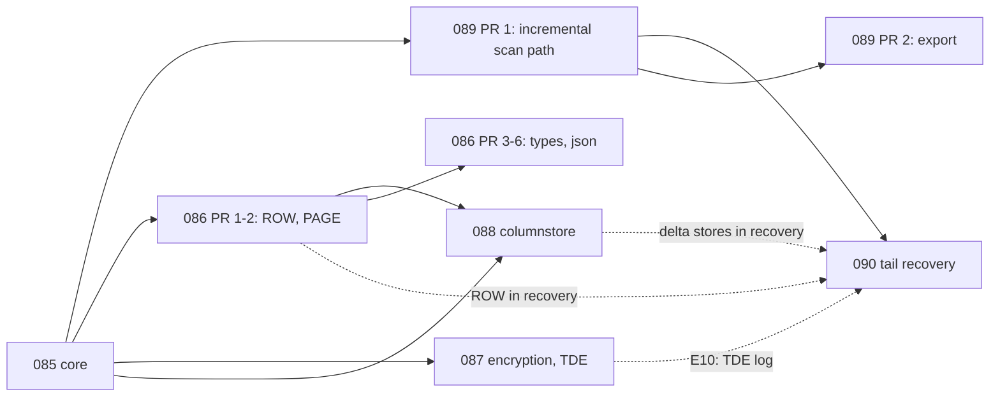

# Backup reader: the spec series (drafts)

Status: **drafts**, 2026-11-05, for review. Not in the repository's `specs/` folder and not committed;
when a draft is accepted it moves to `specs/<number>-<name>/spec.md`. Numbers start at 085 (082 is
reserved; 083 and 084 exist).

The design and every owner decision are in `research/RESEARCH.md` (R§n). The evidence is in
`../../research-*.md` and the experiments `../../experiments/E1`–`E7` (E7, partitioning, finished after
the first draft and is integrated: 085's partition model, 089's ownership rule and maintenance
evidence). The importer that consumes this work is mssql-ducklake; its draft specs are in
`../mssql-ducklake/`. The owner's open questions of both series are merged into one list,
[decisions.md](decisions.md) (DQ-nn).

Markers used in every spec: **(2025)** = verified on SQL Server 2025 RTM-CU8 only, the one build every
experiment ran on; **(unverified)** = inferred or never observed.

## The series

| spec | title | scope in one line | depends on | estimate | risk |
|---|---|---|---|---|---|
| [085](spec.md) | the core | MTF, `MSSQLBAK` (MS_XPRESS, ZSTD), stripes, several data files, page store with liveness, catalog with E7's partition model, FixedVar rows, LOBs and row-overflow, common types, the file functions with the opened-file cache, read-only ATTACH, DuckDB FileSystem I/O, `mssql_backup_info`, the fuzzy status, a differential overlay for browsing | — | 68.5 d, 12.5–14 wk | low–medium (version drift) |
| [086](../086-backup-row-formats-and-types/spec.md) | row formats and types | ROW and PAGE compression, sparse, `sql_variant` → `VARIANT`, `xml`, `geometry` / `geography`, `hierarchyid`, `vector`, double-byte code pages, the 2025 `json` spike | 085 | 37.5 d, 7–8 wk + `json` spike 1–2 wk | medium (ROW / PAGE known only through DbReader's facts); high for `json` |
| [087](../087-backup-encryption/spec.md) | encryption and TDE | the `mssql_backup_key` secret, selection by scope then thumbprint, encrypted containers, TDE pages | 085 | 16.5 d, 3–3.5 wk + E10 spike | low–medium; the TDE log tail is open |
| [088](../088-backup-columnstore/spec.md) | columnstore | E5's decoder in C++: segments, dictionaries, VLD, rowgroups, delete bitmaps, delta stores, archive | 085 (+ CD integers from 086 PR 1) | 37 d, 6–9 wk | medium (version drift) |
| [089](../089-backup-incremental-api/spec.md) | the incremental API | the chain check, changed and freed pages, dead / gone / moved AUs (E7's ownership rule), allocation images, the catalog mirror, LOB fragment maps, lake-mode decoding of a lone differential, the Parquet export with page runs in DuckLake's layout | 085 | 40 d, 8 wk | medium |
| [090](../090-backup-tail-recovery/spec.md) | tail recovery | redo and undo of a backup's own log tail, restore mode and lake mode, pending pages with the allocation-first rule, stale pages with variant 1 | 085, 089 | 55 d, 10–12 wk | medium |

**Total ≈ 255 working days, about 51 weeks for one developer; about 34 weeks with two** (085's 68.5
days, then track A's 84 days beside track B's 101; see below). The `json` decoder (086 PR 6, ~3 d,
only if E9 passes) and the spikes E9–E11 are outside the total.

### Why this split (and where it departs from the suggested one)

The suggested split was kept, with these placements made explicit:

- **The log-tail reader is in 085**, because the fuzzy status needs it (blocks, sector parity, record
  headers, the transaction table); 090 adds the record contents and the engine. Otherwise 085 could not
  report the status the owner asked for.
- **Filter pushdown is out of 085's first cut.** DuckDB 2.0 makes a scan apply every filter it accepts
  (CLAUDE.md); 085 ships projection pushdown and measures filter pushdown with late materialisation
  before committing to it (088 revisits it for rowgroup elimination, where it pays most).
- **`since_lsn` and `mssql_backup_changed_pages` are in 089, not 085.** They are only meaningful
  together with the base state a lone differential needs (089 D4, D5), and 085 stays the restore-a-file
  reader.
- **The Parquet export is in 089**, as its second PR. The owner's "Parquet first" (R§6.2) needs a
  writer that controls page contiguity, which only the reader can do; the plain-SQL path works before
  it, so the importer is not blocked.
- **NCCI reading is dropped from 088**: the scan reads a table's base rowset, which an NCCI duplicates.

## Order and dependencies

**Track A (the lake's critical path): 085 → 089 PR 1 → 090.** After 089 PR 1, mssql-ducklake can import
quiet backups and differentials exactly, refusing a file in which any imported table is not
`consistent` (the owner's "no dirt" holds by refusal, 021 D11). After 090, it imports busy backups
exactly.

**Track B (coverage): 086 PR 1–2 (ROW, PAGE) → 087 → 088 → 086 PR 3–6 → 089 PR 2.** ROW and PAGE first
because real databases use them widely and 088 needs the CD integer decoder; then encryption (small);
then columnstore (required, owner); then the long tail of types; then the export.

With one developer, interleave: 085, 089 PR 1, 086 PR 1–2, 090, 087, 088, 086 PR 3–6, 089 PR 2. The
relative order of 088 and 090 is still the owner's (R§10.4, DQ-03); the two tracks sidestep it.

Each PR merges before the next opens (no stacked PRs).

## Phase map: R§8 against this series

| R§8 phase | R§8 estimate | now | spec | what changed |
|---|---|---|---|---|
| 0: container, page store, catalog, FixedVar, LOB, common types, file functions, cache, ATTACH, fuzzy flags | 6–8 wk, low–med | 12.5–14 wk | 085 | 085 also takes phase 1's overlay, locators and parallel scan (~2 wk) and E7's partition model (2 d), and costs per spec the hardening, fuzz harnesses, CI oracle lane and docs R§9 lists but §8 did not cost |
| 1: ROW / PAGE, sparse, `sql_variant`, xml, spatial, vector; overlay; locators; parallel scan | 5–6 wk, med | 7–8 wk + json spike | 086 | overlay / locators / parallel moved to 085; `hierarchyid` and double-byte code pages added; one oracle test per type |
| 1b: encryption and TDE | 1–2 wk, low–med (E4) | 3–3.5 wk + E10 | 087 | the secret type, the selection rule, CI fixtures; the TDE log tail found open |
| 1c: tail recovery | 9–12 wk, med (E3, E6) | 10–12 wk | 090 | about a week of it (the log reader) is in 085; guard extensions listed separately (ROW and PAGE 2–3, ADR / RCSI 3–4, DDL 1–2 wk) |
| 2: mssql-ducklake import | 3–4 wk, med | not in this series (mssql-ducklake 021–023: 20–26 wk) | — | the reader side of it is 089 (8 wk), which §8 did not cost |
| 3: columnstore | 5–8 wk, med (E5) | 6–9 wk | 088 | E11 (columnstore in differentials) added, NCCI dropped |
| 4: log backups | 3–6 mo, high | not in this series | — | — |
| 5: QAT_DEFLATE, 2025 `json` | open | `json`: 086's spike; QAT: none | 086 | QAT_DEFLATE is refused by name |

## What mssql-ducklake consumes from each

| spec | functions and columns | what the importer does with them |
|---|---|---|
| 085 | `mssql_backup_info` (GUIDs, LSNs, dates, database, family and recovery-fork ids, compression, `consistent`); `mssql_backup_tables` (schemas, tables, columns with DuckDB types, AUs, partition counts, `partitioning` from E7, `fuzzy_status`); `mssql_backup_views`; `mssql_backup_scan` with `_mssql_rid`, `_mssql_page`, `_mssql_page_lsn`; `mssql_backup_catalog` (and its no-argument list of the allow-listed base tables) | the DDL of a full import, the proposed partition and sort specs, the provenance tags and snapshot `extra_info`, views as text in `__mssql_backup.views`, the rows of a full import (v1, Parquet first in plain SQL: `COPY` of the scan to Parquet plus `ducklake_add_data_files`; the export of 089 PR 2 later), refusal of non-consistent tables until 090 |
| 086 | the same functions on compressed tables and the remaining types | real-world tables; `VARIANT` columns (not inlined); `FLOAT[n]` cast to `FLOAT[]` (DuckLake has no `ARRAY`) |
| 087 | the `mssql_backup_key` secret; `needs_key`, thumbprints in `mssql_backup_info` | nothing of its own: secrets apply to the file functions; a TDE backup's status is `unknown` until E10, so the importer refuses it until then (no dirt) |
| 088 | columnstore tables in the scan; rowgroups in `mssql_backup_tables`; ordered-CCI keys | columnstore tables, sort orders; page runs per rowgroup; delete bitmaps as positions (after E11) |
| 089 | `mssql_backup_chain_check`; `mssql_backup_changed_pages` (`changed`, `freed`, `dead_au`, `gone_au`, `au_moved`, `dead_rowgroup`); `mssql_backup_allocation`; `mssql_backup_catalog(…, since_lsn)`; `base` on every 085 function; `mssql_backup_scan(…, since_lsn, base)`; `_mssql_lob`; `mssql_backup_export_plan` / `mssql_backup_export` (with `partition_by`, `order_by`, `target_file_size`, `parquet_options` from the lake) and page-run files `(page, page_lsn, first_pos, row_count)` | chain validation and the stored watermarks; deletes by page in every table and by AU; SWITCH moves by E7's ownership rule; the `__mssql_sys` mirror and the allocation images; the `base/` side files it writes before each apply; Parquet files registered in one commit; the page map |
| 090 | `recovery`, `loaded_diff`, `reflected_lsn` on the scan, the export and `changed_pages`; `fuzzy_status` after recovery; `mssql_backup_pending_pages`; `changed_pages` kinds `pending_*`, `stale` (reasons `baseless`, `skipped_transaction`, `lob`); `base/pending.parquet` | exact full imports of busy databases; the pending images and stale page set kept between files; healing by the next file, checked by the importer |

## Test corpus strategy

**T1 — two kinds of fixtures, with different jobs.**
- **Generated in CI** (the oracle lanes): the authority for every acceptance criterion. Generator
  T-SQL under `test/backup/gen/` (ported from `experiments/E1`–`E6`'s `sql/` and E6's `gen.py`) runs on
  a SQL Server container, the backups land on a host volume, RESTORE gives the truth. Reasons: the
  oracle needs a server anyway; workloads during a backup (E3, E6) and large sizes cannot be committed;
  new cumulative updates are picked up.
- **Small committed samples** (`test/data/backup/`): for the server-free lane (`make test`, every PR,
  every platform, Windows and macOS included, where the docker lane does not run), the fuzz seed
  corpora, and frozen regressions (a file that once broke the reader). Each sample carries its
  generator script, its HEADERONLY output and golden results captured from RESTORE at generation time
  (row count and a canonical SHA-256 per table, a few rows in full). Compressed backups are preferred
  (ZSTD shrank the probe 3.7×, X§2); at most 2 MB per sample and 16 MB in total, **or** a pinned
  test-data release asset fetched by `make test-backup-data` if the owner prefers to keep binaries out
  of the repository.

**T2 — the oracle is RESTORE + SELECT of the same file on the server that wrote it** (R§9). Two
comparisons:
- *canonical* (authoritative): one string per row computed on the server through `mssql_scan` (E3 /
  E6: `CONCAT_WS` of the values, hashes of fillers, `DATALENGTH` + SHA-1 of LOBs; E5: floats as IEEE
  hex, strings and binaries as bytes, dates in styles 23 / 120 / 121) against the same string built from
  the reader's rows; multisets per table;
- *typed* (a cross-check of the type map): the restored database attached as `TYPE mssql`, compared
  with `EXCEPT ALL` both ways. Both sides use one type map (085 D6), so a difference is a decoding bug,
  except where `TYPE mssql` reads lossily (time(7)'s 100 ns digit, datetime2(7) past 2262) or types
  differently (086 D2); those columns rely on the canonical comparison.

Locators are checked against `%%physloc%%` (E1§3).

**T3 — version matrix**: the Linux images `2017-latest`, `2019-latest`, `2022-latest`, `2025-latest`,
each fixture gated by what its version supports (UTF-8 collations from 2019, ordered CCI from 2022,
ZSTD, `vector`, `json` on 2025). Pinned CU tags per PR run, plus a weekly `-latest` run to catch drift.
The lane starts SQL Server with `docker run -v <host dir>:/var/opt/mssql/backup` (not a service
container, so the directory's permissions can be set first: 2019+ images run as uid 10001). 2016 and
older (Windows-only images): best effort, through committed samples contributed with their generator
and HEADERONLY output; no CI.

**T4 — what is never committed**: anything from a real database; any backup made on an instance that
held other data (pad bodies are stale buffer memory: E2§7 found row data of the backed-up database in
26 of 35 files and could not rule out other databases); any key material except a test-only
certificate made for the samples (087).

**T5 — fuzz seeds** are cut from the committed samples: MTF headers, a block chain, single pages,
records, LOB trees, log blocks, columnstore blobs (E5's `blobs/` come from synthetic tables). Each
parser has its harness (listed per spec), DuckDB-free so ClusterFuzzLite runs it per PR.

**T6 — the experiments' own backups** (`experiments/E*/bak/`, up to 961 MB for E6) are research
material, not fixtures; their generator scripts are what is ported.

**T7 — scale**: a manual lane builds a ~100 GB database, backs it up to MinIO (S3), and checks 085's
open-pass and memory bounds.

## Conventions across the series

- **Names**: `backup`, never `bak` (owner). Internals in `src/backup/` (namespace
  `duckdb::mssql::backup`, no prefix), the catalog in `src/catalog/backup/` (namespace `duckdb`,
  `MSSQL` prefix: `MSSQLBackupCatalog`, `MSSQLBackupSchemaEntry`, `MSSQLBackupTableEntry`,
  `MSSQLBackupTransactionManager`), headers mirrored under `src/include/`. Source files
  `backup_<component>.cpp` (085 D16, a proposal).
- **Code**: C++11-compatible (CLAUDE.md: no structured bindings; the ODR rule on Linux). DuckDB 2.0
  contracts: `DataChunk::SetChildCardinality`, `SetFallible()` on throwing scalar functions,
  `FlatVector::GetDataMutable` hoisted out of row loops, a scan applies every filter it accepts,
  table-function bind data serialises (else the common-subplan optimizer may merge two scans).
- **Parsers are DuckDB-free** over byte spans (085 D15), so their fuzz harnesses run per PR.
- **Functions** register through `mssql::RegisterDocumentedFunction`; their parameter names are API.
- **Settings** are `mssql_backup_*`.
- **Refusals name** the object, the feature and the SQL Server type; nothing undecodable becomes NULL.
- **Warnings** (fuzzy status, partial features) go to `duckdb_logs`, one line per table, never per row.
- **Docs** in every PR: README (user-facing), `DATAMODEL.md` (a backup-reader layer section with
  Mermaid diagrams), CLAUDE.md (functions, settings, layout), CHANGELOG.

## New experiments proposed by the series

| id | question | spec | timebox | state |
|---|---|---|---|---|
| E7 | partitioning in a backup | 085 (the partition model), 089 (ownership rule, maintenance evidence), mssql-ducklake 021 / 022 | — | **done** (`../../experiments/E7-partitioning.md`), integrated |
| E9 | the 2025 `json` binary, decoded and gated against `CAST(j AS nvarchar(max))` | 086 | 1–2 wk | planned |
| E10 | the log tail of a TDE backup | 087, 090 | 3–5 d | planned |
| E11 | columnstore in differentials (incl. a partitioned CCI's SPLIT / MERGE), and the tuple mover during a backup | 088, 089 | 3 d | planned |

(E8, the import commit cost, was not run, R§12.) R§12 lists E9–E11 as planned.

## Decisions for the owner

The questions this series raised are merged with mssql-ducklake's into [decisions.md](decisions.md), one
deduplicated list ordered by impact, with the blocking ones marked. This series' fourteen map to:

| here | DECISIONS | here | DECISIONS |
|---|---|---|---|
| 1 fuzzy default for browsing | DQ-13 | 8 service-column types (decided: opaque BLOBs) | DQ-02 |
| 2 minimum SQL Server version | DQ-04 | 9 lake state as Parquet side files | DQ-12 |
| 3 `mssql_backup_catalog` allow-list | DQ-11 | 10 LOB splice source | DQ-01 |
| 4 `backup_<component>.cpp` names | DQ-37 | 11 the export in mssql | DQ-18 |
| 5 `VARIANT` / `FLOAT[n]` | DQ-19 | 12 `recovery := true` for browsing | DQ-13 |
| 6 spatial Z / M, CRS | DQ-20 | 13 order of 088 / 090, guard order | DQ-03 |
| 7 `key_secret` override | DQ-29 | 14 committed samples or a release asset | DQ-36 |

The consistency pass added DQ-05 (lakes born before 089 carry no LOB maps), DQ-06 (an unhealed
stale page: error or report), DQ-07 (columnstore under load: refuse or mark stale), and the shape
questions of DQ-02. The owner's 2026-11-05 decision to follow DuckLake's rules for partitioning and
file layout is recorded there as DQ-10 (decided).

## Not in this series

Log backups and CDC (R§8 phase 4); QAT_DEFLATE; mssql-ducklake's import specs; changes to the live
`TYPE mssql` catalog's type map; forensic recovery of deleted or pad data (the reader returns what
RESTORE returns); writing backups.
