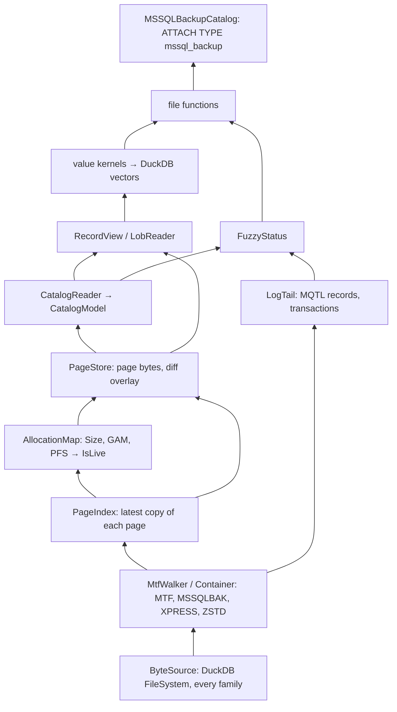

# Spec 085: reading a backup file — the core

Status: **draft**, 2026-11-05. Not started. Part of the backup-reader series (see `../README.md`).
Design and every owner decision: `design/001-mssql-backup-reader/RESEARCH.md` (cited as R§n).
Evidence: `research-experiment.md` (X§n), `research-web.md` (W§n), `research-architecture.md`
(A§n), experiments E1–E7 (`experiments/E<n>-*.md`, cited as E<n>§m). The owner's decisions:
[decisions.md](decisions.md) (cited as DQ-nn; each one decided or accepted). DuckLake source is cited
as `DL/` = mssql-ducklake's `ducklake/src/` at `dcf71031`, DuckDB source as `DD/` = this repository's
`duckdb/` submodule at `d54cbbe3df1` (the pin).

Markers used below: **(2025)** = verified on SQL Server 2025 RTM-CU8 (17.0.4075.5, Linux) only, the one
build every experiment ran on; **(unverified)** = inferred, not observed. E7 (partitioning) finished
after the first draft; its results are integrated, and no point waits for it any more.

## Problem

A SQL Server backup file is today readable only by RESTORE on a SQL Server. The research (R§2–§3, X)
showed that the file alone is enough: the container, the pages, the system catalog and the rows of
every common type decode byte-exact with no server. This spec builds that core inside the mssql
extension:

- the container: MTF, the `MSSQLBAK` compressed container with MS_XPRESS and ZSTD, striped media
  sets, several data files, pads skipped;
- the page store with the liveness rule;
- the catalog reader;
- the row engine for uncompressed rowstore: FixedVar records, LOBs and row-overflow, forwarded
  records, ghosts, the uniquifier;
- the common types;
- the file functions with the opened-file cache, and a read-only ATTACH for browsing;
- I/O through DuckDB's file system, so httpfs and azure apply;
- `mssql_backup_info` with the header fields E1 located;
- the fuzzy status of a backup from its log tail (E3);
- a differential laid over its full backup, for browsing.

It returns the database **as of the backup's CheckpointLSN**, dirty reads included (E3§2), and says so
per table. Making a busy full backup exact (redo and undo of its own log tail) is spec 090.

## Scope

In: everything above.

Out, each refused by name until its spec lands -- storage formats, never a type (owner, 2026-11-11):
a type whose conversion is still to come is read as its stored bytes (below).

| feature | where | refusal scope |
|---|---|---|
| ROW / PAGE compressed rowsets | 086 | the table |
| sparse columns (the sparse vector) and the column set | 086 | the column, when projected |
| encrypted backups, TDE databases | 087 | the file |
| clustered / nonclustered columnstore | 088 | the table (an NCCI is ignored: the scan reads the base rowset) |
| `since_lsn`, changed / freed pages, the export, lake-mode state | 089 | — |
| redo / undo of the log tail | 090 | — |
| QAT_DEFLATE (Windows, framing unknown, W§3) | none | the file |
| log backups (`.trn`) | phase 4 of R§8, not in this series | `mssql_backup_info` only; a scan is refused |
| FILESTREAM, memory-optimized tables (unverified: never produced in an experiment) | none | the table |

## Decisions

- **D1 — a separate catalog type inside mssql (owner, R§6.1).** `ATTACH 'x.bak' AS b (TYPE
  mssql_backup)` registers a second `StorageExtension` next to `TYPE mssql`
  (`src/mssql_storage.cpp:1232,1650`, A§1). The catalog is **always read-only** (owner, R§6.1): the
  attach forces `AccessMode::READ_ONLY`, so DuckDB's own check refuses every write, and the catalog
  implements no write path at all. It has its own trivial transaction manager, no pool, no remote
  pushdown, and no `MSSQLOptimizer` rewrites. Reason: the decoders, the type map and the collation
  tables come from the same binary with no drift; the ~10 sites that test
  `GetCatalogType() == "mssql"` (A§1) keep their meaning because `mssql_backup` is a different type.

- **D2 — file functions first, ATTACH built on them (owner, R§6.1 item 7).** Every function takes the
  backup's path; nothing needs an ATTACH. The catalog and the functions share one `OpenedBackup`
  object (D9). Reason: the importer (mssql-ducklake) generates SQL over files, as it does over
  `mssql_scan` today, and an ATTACH inside its PRAGMA expansion would add DETACH problems
  (A§2: a DETACH inside an expanded PRAGMA is refused).

- **D3 — I/O only through DuckDB's file system (owner, R§6.1 layer 1).** Files open through
  `CachingFileSystem::Get(context).OpenFile(path, FILE_FLAGS_READ)` (D3a), which wraps the
  client-context file system that carries the opener
  (`DD/src/include/duckdb/storage/external_file_cache/caching_file_system.hpp:152-159`), so `s3://`,
  `gs://`, `r2://`, `https://` (httpfs) and `az://`,
  `abfss://` (azure) work with the user's DuckDB secrets, and DuckDB autoloads the extension for the
  scheme (`virtual_file_system.cpp:428`). Reads are positional, so threads share one
  `shared_ptr<CachingFileHandle>`. No SDK, no own HTTP, no own credential handling.

- **D3a — reads are ranges, coalesced, fetched asynchronously and in parallel, as the Parquet reader
  does (owner, 2026-11-09; DQ-38).** On httpfs a positional read is an HTTP range request, so the
  layer above the parsers works in ranges, never in a stream:
  - **Ranges, coalesced.** A consumer asks for the byte ranges it needs (a unit's pages, a block, a
    header); adjacent and nearly adjacent ranges are merged into one request, as Parquet merges its
    read heads within a 16 KiB gap (`DD/extension/parquet/include/thrift_tools.hpp:61-79`,
    `AddReadHead` `:107-130`), and the merged range is split again by the reader at a size that suits
    the pins it can afford: one `CachingFileHandle::Read` pins its whole range. Below that, the
    caching handle cuts a remote read into cache blocks of at most
    `external_file_cache_remote_max_block_size` (2 MiB by default) and fetches them in parallel on the
    ASYNC pool (`DD/src/storage/external_file_cache/caching_file_system.cpp:378-418`). A local file
    reads the same way.
  - **Asynchronous.** The fetches run as `AsyncTask`s on DuckDB's I/O pool:
    `AsyncResult::FromTasks(…, TaskSchedulerType::ASYNC)` (`DD/src/include/duckdb/parallel/async_result.hpp`,
    the pool `async_threads` sizes), returned as a `BLOCKED` result from the table function, so the
    decode threads do not wait on the network. Any plain table function may do it: the table scan
    runs in TASK_EXECUTOR mode by default (`DD/src/parallel/async_result.cpp:284-294`) and schedules
    the tasks, or runs them with `ExecuteTasksSynchronously(context)` when it cannot block
    (`DD/src/execution/operator/scan/physical_table_scan.cpp:171-206`;
    `TableFunctionInput::HandleBlocked` runs them side by side, `DD/src/function/table_function.cpp:214-231`).
    Its limits: a `BLOCKED` result comes with an empty chunk (`physical_table_scan.cpp:150-155`), only a
    `function` may block (not an `in_out_function`), and the multi-file wrapper forces SYNCHRONOUS
    (`DD/src/common/multi_file/table_function_multi_file.cpp:376`), so 085's functions do not use it.
  - **Cached.** Reads go through DuckDB's `CachingFileSystem` / `ExternalFileCache`
    (`DD/src/include/duckdb/storage/external_file_cache/`), whose buffers are the buffer manager's,
    counted against `memory_limit` (D17). A **remote** file is cached when `enable_external_file_cache`
    is on (the default) and the file has validation metadata (ETag or last-modified); its blocks are
    evictable once unpinned, so an importer calling the functions once per table on one file, beside
    D9's opened-file cache, usually fetches a range once (an evicted block is fetched again). A
    **local** file is not cached by default (`cache_local_files` is off,
    `DD/src/storage/external_file_cache/external_file_cache.cpp:103-110`): its reads are counted
    buffers freed on release.
  - **The open pass in parallel.** Only the MTF headers are walked one after another (a few small
    reads). An uncompressed MSDA is one run of 8 KB units, each naming its own page (D4), so once its
    stream header gives its extent the page index is built from many ranges fetched at once. A
    compressed chain (`MSSQLBAK`) is a run of headers each giving the next one's offset, and its seek
    index (§ Rules, MSSQLBAK) names only the blocks that start each data pass and the trailer, not
    every block (task 4, 16 of 16 containers). So the chain is fetched ahead in large ranges in
    parallel, its headers walked in the fetched bytes (cheap, sequential), its blocks decompressed on
    every thread (D10), and the passes the index separates walked side by side. `mssql_backup_info`
    needs no walk: the first block holds SSET, VOLB and MSCI, and the last index entry the trailer.
  - **LOB trees** are fetched one level at a time: a node's children are known only once it is read,
    so the ranges of one level are coalesced and fetched together.
  - The parsers stay DuckDB-free (D15): they take spans the I/O layer has fetched.

- **D4 — the page store is an index by page id, gated by liveness; a table's pages come from its IAM
  chain (owner, 2026-11-09, DQ-40).** A page names itself
  (`m_pageId` @32, `m_fileId` @36, X§3), so the store is `(file_id, page_id) → location of its latest
  copy`. The later MSDA pass wins over the earlier (X§3, E3§2: reading only pass 1 doubled the error).
  A page's rows are read, and its header allocation-unit id is believed, **only if the page is live**
  (E2 R3): below its file's `Size`, its extent GAM-allocated, its PFS byte with 0x40. Full backups
  carry dead pages too (E2§1.3: 42 `BULK_OP_PREALLOC` pages in a full; 34 and 53 freed data pages with
  live-looking records after a shrink).
  - **Which pages are a table's: the allocation unit's IAM chain**, read through the page store (so
    each IAM page's latest copy). The chain starts at `sysallocunits.pgfirstiam`; each IAM page covers
    one GAM interval from its start page and lists the AU's uniform extents (a bitmap) and up to eight
    single pages in mixed extents (§ Rules, allocation). A listed page enters a scan only if it is live
    (R3). Walked at the table's first scan, not at open (D4a), so an open reads no table's pages.
  - **The page header is the check, not the map.** The scan reads every page it uses whole, so the
    header AU of each live page is compared with the AU being read, and a disagreement is a named
    error: E2 found the header AU equal to the owner on 10,473 of 10,473 allocated pages, after
    SHRINKFILE and REBUILD too (E2§2, R4), and stale only on pages R3 already drops or on dead AUs the
    catalog does not scan. E2 preferred the header as the map for differentials, which lack the IAM
    pages of unchanged AUs; through the page store those come from the full.
  - **A differential's own pages are read the old way, by their header AU** (owner, 2026-11-09): its
    pass is indexed from its page headers anyway (D4a), so its `(AU, page)` pairs cost no extra read.
    Under an overlay a table's scan takes the diff's live pages whose header names its AU, and the
    full's pages by the AU's IAM chain through the overlay (the diff's copy of an IAM page that
    changed), both gated by R3 on the overlay's allocation pages, one copy per page id (task 24).
    `verify := true` also checks that the two agree where both speak.

- **D4a — what an opened backup keeps, and the budget: at most 0.4 MB of resident memory per GB of
  backup, 4 GB for 10 TB (owner, 2026-11-09).** The open pass may be slow (a backup is opened once per
  instance, D9); what must be fast is a bind and a read. So the opened backup keeps three tiers:
  - **Resident while the backup is open** (pinned; what every bind and every page read needs):
    the headers (families, sets, data files, `mssql_backup_info`'s fields); per pass a bitmap of the
    extents it carries with a rank directory, so a page's place in the stream is the rank of its
    extent among the pass's extents, found in O(1) (≈ 21 MB per pass and 2.6 MB of ranks for 10 TB);
    per pass the samples its searches have found (DQ-41, E13: a block's or group's offset and the
    extent it names, tens of bytes each, one per probe made), so a striped or compressed pass is
    searched, never walked whole; the catalog model (schemas, tables, columns,
    types, a table's AUs, its partitioning: grows with objects, not data); the per-table fuzzy status;
    per data file its `Size` and GAM bits (one bit per extent, ≈ 21 MB for 10 TB; PFS pages are read
    on demand, one per 8,088 pages, and the last few kept); per AU its catalog row (`pgfirstiam`,
    `pgfirst`, `pgroot`) and per rowset `rcrows`, so a bind has its cardinality and a first scan its
    IAM chain's first page with no lookup. Typically 0.1–0.2 GB for 10 TB.
  - **Buffer-managed, spilled under pressure** (counted against `memory_limit`, D17): per AU the
    extent runs and single pages of its IAM chain (DQ-40), built at the table's first scan from its
    IAM pages (one 8 KB page per 4 GB of the file the AU spans, fetched as parallel ranges, D3a) and
    kept in the opened backup for every later scan; a scan pins its table's. Typically tens of MB;
    up to ≈ 2 GB for a 10 TB table whose extents interleave with another's. A differential's
    `(AU, page)` pairs from its header pass (D4). Also the raw base tables when
    `mssql_backup_catalog` asks for them.
  - **What an ATTACH reads**: the MTF headers (a container's seek index: its pass boundaries), the
    allocation pages (E12, below; found by search in a striped or compressed pass, DQ-41), a header
    pass over pass 2 and a differential's pass, and the catalog's base tables (read through their
    own IAM chains). Enough to list the schemas, tables and views and to bind them; no user table's
    pages and no IAM page of one.
  - **Not kept**: page bytes (fetched as ranges, D3a; a remote file's in `ExternalFileCache`), decoded
    pages, LOB values (the scan's working memory, bounded by `max_memory`), log records (only D11's
    flags stay), the open pass's intermediate records (freed once the index is built).
  - **The stream order is checked, not assumed.** A pass's extents must come in ascending (file, page)
    order for the rank to give their place; the open pass checks it, and a pass or a stretch of one
    that breaks it is recorded as explicit runs `(file, first extent, count, offset)`: a loss of
    compactness, never of correctness.
  - **A page's type, level and `m_lsn` are not indexed**: the scan reads them from the page it reads
    anyway (and skips the index pages there); D11's check (iv) reads the few pages the log tail names.
    Spec 089's changed set (`m_lsn > since_lsn` on every live page, 089 D3) is computed by 089's own
    pass over the page headers when `since_lsn` is given, not stored in this index.
  - **E12 (done, `research/experiments/E12-gam-rank.md`)**: a single-family full backup's first pass
    is one 8-unit group per extent of (GAM-allocated extents ∪ allocation-page extents), in ascending
    (file, extent) order, then pad groups only (56 of 56 fulls, compressed and under load included
    **(2025)**). So the open of such a backup reads the file headers and the GAMs (at ranks the GAMs
    give: 2,560 GAM pages for 10 TB, at most 160 MB as the 64 KB groups that hold them) and the MTF
    headers, not every page; the extent bitmap is the GAM's, and the PFS pages are read when a scan
    needs them (D4a's allocation tier). Pass 2 and a differential's pass (small; a differential's for
    its `(AU, page)` pairs, D4) are indexed from their page headers, one per 8-unit group. The rule
    is checked where the reader reads a group, never trusted blindly.
  - **E13 (done, `research/experiments/E13-ordered-passes-search.md`) and DQ-41: a striped or
    compressed pass is searched, not read.** Every pass is ascending by (file, extent) (210 of 210:
    pass 1 and 2, fulls and differentials, plain and compressed, each family of a striped set);
    in a container every block of a pass outputs exactly 64 KB from a unit boundary, so block *k* is
    the pass's extent group *k*, and the seek index names the pass boundaries. So an extent's group
    is found by searching the pass: in a family file group *g* is at a computed offset (bisection
    over groups). Probes are kept as samples; measured on the samples: 6–8 requests a cold lookup,
    0.4–1.9 warm. A probe that meets a key out of order refuses the search for that pass, which falls
    back to its header scan (a loss of speed, never of correctness).
  - **A container is searched safely by default** (owner, 2026-11-09, DQ-41): a block found from an
    arbitrary offset can be forged by row data (§ Security), so by default a container's group *g*
    is read at its data-set offset through the chain walked from its start or a seek index entry,
    lazily, a mark kept every 256 KiB of the file walked (the stream located from its tail, task 7a
    part 4a; as landed in PR 2e, a span between checkpoints is walked only up to the block read); the
    search over such a pass gallops from the nearest walked sample (1, 2, 4 … groups, then bisects),
    so it walks at most twice as far as the group it finds. Neither the rank path nor the GAMs run at
    ATTACH for a container: the GAM of an interval is read when a page of it is first located
    (D4a's allocation tier), and the catalog, at the start of pass 1, costs a short walk. A first
    scan of a table deep in the file walks the chain to it (on object storage, reads the file up to
    it). `trust_layout := true` uses E13's resync instead (a probe at any offset finds a block by the
    next four plausible headers, the fourth always a true block in 3.6 M probes): the open and a
    first scan then read little of the file, and the trust in the rows is the caller's.
  - **A saved index is a later option**, not part of 085: written to a path the user names
    (`temp_directory` does not outlive the process), keyed by `BackupSetGUID`, the families' sizes and
    version tags.

- **D5 — the catalog from the backup alone, data-driven per version.** The boot page gives the
  database name, version, collation and the first `sysallocunits` page (X§4). Five base tables have
  hard-coded layouts (`sysallocunits`, `sysrowsets`, `sysschobjs`, `syscolpars`, `sysrscols`); every
  other base table is decoded generically through its own `syscolpars` / `sysrscols` rows (X§4: the
  22 columns of `syscscolsegments` came out that way; E7: every partitioning table came out that way
  too, 0 mismatches against the catalog views in 16 database states). The five layouts are a table
  keyed by `dbi_version`, not code branches; only 998 (2025) is verified, and the other versions' rows
  are filled by the CI version matrix (D14).

- **D6 — one type map, shared with `TYPE mssql`.** A column's DuckDB type is
  `MSSQLColumnInfo::MapSQLServerTypeToDuckDB` (`src/catalog/mssql_column_info.cpp:199`), with native
  types off: strings are plain `VARCHAR`. Reasons: a restored database attached as `TYPE mssql` and the
  backup then report the same types, which is what the oracle tests compare (§ Testing); DuckLake
  rejects alias and collated string types (A§1, `ducklake_types.cpp:158-163`). The reader needs a
  `system_type_id → name` table for it. The deliberate exceptions, where a backup can return what the
  wire cannot, are spec 086's (`sql_variant` → `VARIANT`, `vector` → `FLOAT[n]`); 085 has none. A type
  whose conversion is still to come is its stored bytes, a `BLOB`, until then (D13).

- **D7 — values go through the codec layer's batch kernels.** The row engine copies each value's
  bytes into the codec's column-major staging (`codec/staging/column_staging.hpp`) and finalises one
  column at a time with the family's `DecodeChunkFromStaging` where the on-disk bytes equal TDS's
  (integers, float, decimal, uniqueidentifier, date, time, datetime2, datetimeoffset, nvarchar, UTF-8
  varchar; W§7, A§1). Own kernels, in the same shape, for the bytes that differ: `datetime` and
  `smalldatetime` (time first on disk), `money` / `smallmoney` (a plain little-endian integer) and `bit`
  (packed). No per-value type dispatch (the repository's rule: one batch call per column). The per-row
  work is the record walk, which is inherent.

  The code-page transcode of a `char` / `varchar` column under a non-UTF-8 collation is a vectorized
  kernel, one pass, one call per column per chunk, never per value: ASCII stored a block at a time,
  the rest by arithmetic on the page's run or by table, with kernels specialised to the frequent pages
  (spec 091 D5 / D5a, PR #527). The tables come from SQL Server itself: spec 091's generator reads
  every byte, and every DBCS lead / trail pair, in a scratch database whose default collation has the
  page (a `COLLATE` would convert the characters instead), and checks a second collation per page;
  an invalid sequence comes out as the server makes it. Not iconv, ICU or Python's codecs: they
  differ from the server in places, and are platform-dependent or heavy. The same
  generator writes the collation → code page table (`tools/code_pages/data/collations.psv`, § Rules,
  catalog). Spec 091 (SQL Server code pages, generated tables and vectorized kernels) builds it all,
  as the module `src/codec/code_page/`; 085 and 086 reuse it. 085 maps the on-disk CollationId onto
  091's table and reuses its tables, the double-byte pages included (task 13; owner, 2026-11-11: a
  backup has no server to convert a varchar, so every page is decoded on the client -- the TDS path
  keeps the server's cast for a double-byte page only because there the server is faster, 092 D10).

- **D8 — service columns are virtual columns with a `_mssql_` prefix (owner, R§5, R§10.2).** The
  scan and the catalog's table entries expose:

  | column | type | meaning |
  |---|---|---|
  | `_mssql_rid` | `BLOB` | stable row identity. Heap: `0x00 ‖ u32 page ‖ u16 file ‖ u16 slot` of the row's **original** location (the forwarded record's back pointer when it moved); after the shape byte, equal to `%%physloc%%` (E1§3). Clustered rowstore: `0x01`, then per key column in `ordkey` order `u16 length ‖` its uncompressed storage bytes (`0xFFFF` for NULL), then `u32` uniquifier for a non-unique index (0 when absent). Columnstore: spec 088 |
  | `_mssql_page` | `VARCHAR` | the page the row lives on now (E1§2), as the uppercase hex of a shape-byte encoding, fixed width per shape: a page is `01` + 4 hex digits of file id + 8 of page id, 14 characters (file 1, page 0x1A2 = `010001000001A2`). A compressed columnstore row has no page: its rowgroup key is `02` + 16 hex digits of rowset id + 8 of rowgroup, 26 characters (spec 088 D3); a delta-store row has its delta page in the `01` form. Hex digit order is byte order, so within a shape string order is page order |
  | `_mssql_page_lsn` | `DECIMAL(25,0)` | that page's `m_lsn`, in `RESTORE HEADERONLY`'s numeric form; a scan column only (below) |

  The clustered encoding uses the uncompressed bytes so that a rebuild with another `DATA_COMPRESSION`
  keeps every identity (E1§3: key + uniquifier survived REBUILD for 3,188 of 3,188 rows). `_mssql_lob`
  comes with PR 3 in its plain form (DQ-05, task 20), so a phase-A lake has its LOB maps from the first
  import; 089 uses them for differentials. Every lake service column is an opaque value serialized and
  read only by this code, each starting with a shape (DQ-02): only the importer reads them, and a lake
  materialises them, so their format is versioned rather than typed. `_mssql_rid` and `_mssql_lob` are
  `BLOB`s. `_mssql_page` is hex `VARCHAR` so that DuckLake's file statistics prune its deletes (owner,
  2026-11-06): DuckLake builds no file filter for a `BLOB` column
  (`DL/storage/ducklake_metadata_manager.cpp:1764-1765`), and a 26-character value keeps its min/max
  under mssql-ducklake's `stats_length` (1024 by default, its spec 018). `_mssql_page_lsn` is a scan
  column only: no lake stores a page LSN, because which pages changed is decided by the file (the DCM and
  `m_lsn > since_lsn`, spec 089 D3; R§6.2 point 4). The lake deletes by `_mssql_page` with DuckLake's own
  `DELETE` (R§6.2).

- **D9 — the opened-file cache (owner, R§6.1).** An import calls the functions once per table on the
  same file, and a cold open costs a pass over the whole file. The opened backup is kept in DuckDB's
  per-instance `ObjectCache` (`storage/object_cache.hpp`), keyed by every family file's canonical path,
  size and version tag (`GetVersionTag`, the ETag, else `GetLastModifiedTime`), and re-checked against
  `BackupSetGUID` after opening. The entry reports `GetEstimatedCacheMemory`, so it is evictable under
  memory pressure; an attached catalog holds a `shared_ptr` and pins it. A file whose size or version
  tag changed is reopened, never trusted.

- **D10 — MS_XPRESS blocks decode one at a time.** R§3 and W§3 (from Internals Viewer) say the match
  window spans blocks, which would force a sequential pass. Our own decoder
  (`tools/xpress_huff.py`) starts every block with an empty history and raises on a match before the
  block's start; it decoded 181 of 181 blocks of the MS_XPRESS sample (X§5) and every block of E4's
  encrypted-and-compressed sample **(2025)**. So the container keeps a block index, a page read
  decompresses one block (≤ 64 KB), and the open pass decompresses blocks on all threads. A match
  before the block start is a named error, not a silent fallback; if an older version shows one, a
  history-carrying sequential decoder is added for that version. ZSTD blocks are self-contained
  frames (W§3, X§5).

- **D11 — the fuzzy status comes from the log tail (E3§4, §7).** The flag that worked at table level
  in every run (precision 1.00, recall 1.00 over 54 table-runs) is (v) = (iii) ∪ (iv):
  - (iii) a transaction open at `LastLSN` has a row operation on one of the table's allocation units;
  - (iv) a committed record in the tail is newer than the copy of its page, or its page is not in the
    backup.

  Not "page LSN > CheckpointLSN": its recall was 0.42, because a page copied before it changed keeps
  its old LSN. Status per table: `consistent`, `stale`, `dirty`, `stale+dirty`; database level
  `consistent` iff no open transaction and no committed row operation after `CheckpointLSN` (E3§4).
  The `fuzzy` parameter: `'warn'` (default; rows returned, one `WARNING` per affected table in
  `duckdb_logs`), `'error'` (affected tables refused by name), `'ignore'`. R§10.3 is settled for the
  lake by the owner's no-dirt decision (R§4): the importer always passes `'error'`. For browsing the
  default is `'warn'`, with 090's `recovery := true` (DQ-13, accepted). The log-tail reader is built
  here and extended by 090.

- **D12 — a differential overlay for browsing.** `diff :=` names one differential backup (a path, a
  glob or a list of its stripes). The chain is checked first: the diff's `DifferentialBaseGUID`
  equals the full's `BackupSetGUID` and both carry the same `dbi_familyGUID` (E1 rule 1). Pages of
  the diff win; liveness is then recomputed from the overlaid allocation pages (E2 `apply_diff`: a
  naive overlay doubled every row after a shrink). Several differentials are refused: they are
  cumulative (W§10), only the latest matters. A differential given as the path, with no full, is refused
  naming both ways out (`diff :=` on its full, or spec 089's `base :=`): it lacks every catalog page
  that did not change since its base (089 D5). Without spec 090 the overlay reflects the diff's
  `CheckpointLSN`; the fuzzy status is the diff's.

- **D13 — refuse by name at the narrowest scope, never fill with NULL; never refuse a type (owner,
  2026-11-11).** A storage format the reader does not read yet is refused: a column when projected
  (`SELECT` of the other columns works: a sparse column, a value stored off row until PR 3), a table
  when scanned (ROW / PAGE compression, a clustered columnstore), a file at open; the message names
  the object, the feature and the SQL Server type. A *type* is never refused: one the reader
  converts takes D6's type, and one whose conversion is still to come -- `sql_variant`, `xml`, the
  CLR types (`geometry`, `geography`, `hierarchyid`, a user's), `vector`, `json`, a type the reader
  does not know, a text whose collation is newer than the code-page tables -- is its stored bytes as
  they are, a `BLOB`, with `columns.reason` saying why (`ReadingOf`); the conversion is the reader's,
  into DuckDB's types wherever one fits (owner, 2026-11-11: no flag for it). Their
  conversions come with 086, together with the TDS path's (one decoder for both). A computed column
  that is not persisted has no stored value: not readable, named.

- **D14 — versions.** `dbi_version` 998 (2025) is verified. 869 / 904 / 957 (2017 / 2019 / 2022,
  expected values, unverified) are accepted once the CI version matrix passes on their images;
  any other value is refused by name unless `unsupported_version := true`. The minimum supported
  version is 2017, the oldest Linux image the CI can run (DQ-04, accepted; R§10.5).

- **D15 — parsers are DuckDB-free.** Everything under `src/backup/` below the function layer takes
  byte spans and returns plain structs, with no DuckDB headers, so its fuzz harnesses run in the
  per-PR ClusterFuzzLite job (`fuzz/README.md`: the libduckdb-linked harnesses cannot). The DuckDB
  types appear only in the value kernels, the functions and the catalog.

- **D16 — names.** `backup` everywhere, never `bak`, and the folders `src/backup/` and
  `src/catalog/backup/` (owner, 2026-11-05, given with this series; R§6.1 had listed the layout as a
  proposal). Internals in `duckdb::mssql::backup` with no prefix; catalog classes
  in `duckdb` with the `MSSQL` prefix (CLAUDE.md's namespace rule). Source files
  `backup_<component>.cpp`, the peer of `tds_<component>.cpp` (DQ-37, accepted; CLAUDE.md's file rule,
  which names only `mssql_` and `tds_`, is extended to name it).

- **D17 — resources: no OOM, every core, DuckDB's limits (owner, 2026-11-06).** Do not load
  everything into memory, use the machine to the full for parallelism, never fail with OOM, respect
  DuckDB's memory and thread limits, and offer limits on the import itself. 086–090 cite this rule, and
  so do mssql-ducklake's 022 D12 and its 023 / 024; § Resources lists each component with its home or
  its bound.
  - **DuckDB's limits are the ceiling.** `memory_limit` (an alias of DuckDB's `max_memory` setting,
    `DD/src/main/config.cpp:275`) and `threads` are GLOBAL settings, for the whole instance
    (`DD/src/common/settings.json:1201-1210`, `:1534-1543`). Spilling goes to `temp_directory`, up to
    `max_temp_directory_size`, global too (`:1517-1523`, `:1221-1227`). The `max_memory` parameter
    below is per call, unlike DuckDB's `max_memory` setting.
  - **Whatever grows with the input lives in DuckDB's buffer manager**, so it is counted against
    `memory_limit` and spills: buffer-managed blocks, a `ColumnDataCollection` built with the
    `ClientContext` and its default `BUFFER_MANAGER_ALLOCATOR`
    (`DD/src/include/duckdb/common/types/column/column_data_collection.hpp:37-41`), DuckDB's sort.
    The `Allocator&` constructors build an in-memory collection that cannot spill (`:29-32`); none is
    used to accumulate. The rest is bounded by a stated budget, and that working
    memory (a chunk's staging, a LOB value being assembled, a writer's row group) is reserved before it
    is allocated, with `BufferManager::ReserveMemory`
    (`DD/src/include/duckdb/storage/buffer_manager.hpp:100-103`). So it is counted too, under the tag
    `EXTENSION` of `duckdb_memory()`.
  - **One rule for a failed reservation.** `ReserveMemory` evicts blocks or throws
    `OutOfMemoryException` through `EvictBlocksOrThrow`
    (`DD/src/storage/standard_buffer_manager.cpp:775-783`, `:127-138`). Every reservation, the
    reader's and mssql-ducklake's importer's (022 D12), follows one rule: one that does not fit, in its
    budget or in DuckDB's, first waits for other units to release memory; one that still cannot fit
    when its unit is alone is refused by name, naming the object, the size, `max_memory` and
    `temp_directory`. With no `temp_directory` nothing spills (`InMemoryWarning`, `:765-773`), so the
    limits are hard. An in-memory DuckDB has one, `.tmp`, unless `temp_directory` is set to `''`
    (`DD/src/main/config.cpp:651-659`).
  - **Parallelism is `threads`, throttled by memory, never the other way round.** The table functions
    report `MaxThreads()` from their units, and DuckDB runs at most that many tasks of a pipeline on its
    own threads (`DD/src/parallel/pipeline.cpp:127-166`).
  - **Backpressure.** When the budget is reached, a unit waits, or a writer flushes and closes a file.
    Nothing allocates past the budget, and no stage decodes everything before anything is written.
  - **Out of temp space.** DuckDB throws from `TemporaryFileManager::IncreaseSizeOnDisk`
    (`DD/src/storage/temporary_file_manager.cpp:647-659`); the reader refuses the file by name, naming
    `max_temp_directory_size`. Nothing it allocates escapes DuckDB's accounting, so nothing is killed
    for memory.
  - **Limits on one call.** `memory_limit` and `threads` are instance-wide, so a narrower limit for one
    import cannot be a `SET` without changing every other session. The reader's own components enforce
    it: `max_memory := <bytes or '2GB'>` and `max_threads := <n>` on `mssql_backup_scan`, which decodes
    in parallel, and on `mssql_backup_export` (089); 090 adds them to every function that recovers
    (090 D9), and mssql-ducklake's export and commit take the same names (022 D12). The default is
    DuckDB's own limit; a value above it is clamped to it, with a WARNING. They bound the reader's own
    allocations, by the split below (the decode staging, LOB values, 090's recovery structures, 089's
    writers: F comes from `max_memory` / 4), and its concurrency (`MaxThreads()` ≤ `max_threads`).
  - **The split of `max_memory`.** A call's `max_memory` is its whole budget. Half of it is left to
    DuckDB's operators around the reader, its sorts and hash tables: mssql-ducklake gives its side
    connections `operator_memory_limit = max_memory / 2` (022 D12). The reader's and the importer's
    own reservations (decode staging, LOB values, writers, recovery structures) stay under the other
    half, and the export's writers take at most half of that: F comes from `max_memory` / 4 (089).
  - **What they cannot bound**: the DuckDB statements around the reader (an importer's `DELETE` scans,
    a SWITCH's copy, a sort) obey the instance's limits. DuckDB has one per-connection memory knob at
    the pin, `operator_memory_limit` (scope local, `DD/src/common/settings.json:1260-1266`): it caps a
    connection's sorts and hash tables at the smaller of it and the instance's limit
    (`DD/src/main/client_data.cpp:126-133`; read by `TemporaryMemoryManager`,
    `DD/src/storage/temporary_memory_manager.cpp:106`). The importer sets it to `max_memory` / 2 on its
    own side connections (the split above, 022 D12); the reader never sets a caller's. There is no
    per-connection thread knob: `threads`, `external_threads`, `async_threads` and `pin_threads`
    (which pins threads to cores) are all global (`settings.json:1534-1543`, `:958-967`, `:174-180`,
    `:1315-1321`).

## Design

### SQL surface

```sql
-- the backup sets on a media set: HEADERONLY + LABELONLY, with FILELISTONLY as a nested list
SELECT * FROM mssql_backup_info('s3://bak/sales_full.bak');

-- tables, columns (SQL Server and DuckDB types), allocation units, row counts, fuzzy status
SELECT * FROM mssql_backup_tables('s3://bak/sales_full.bak');
SELECT * FROM mssql_backup_views('s3://bak/sales_full.bak');            -- T-SQL text

-- a base table as stored (the importer's mirror; allow-listed, see Security)
SELECT * FROM mssql_backup_catalog('s3://bak/sales_full.bak', 'syscolpars');
SELECT * FROM mssql_backup_catalog('s3://bak/sales_full.bak');   -- the allow-listed base tables

-- one table's rows
SELECT id, amount, _mssql_rid, _mssql_page
FROM mssql_backup_scan('s3://bak/sales_full.bak', 'dbo', 'orders');

-- a differential over its full, for browsing
SELECT * FROM mssql_backup_scan('full.bak', 'dbo', 'orders', diff := 'diff_2026-11-05.bak');

-- browsing as a catalog (read-only whatever the options say)
ATTACH 's3://bak/sales_full.bak' AS b (TYPE mssql_backup, diff := 's3://bak/sales_diff.bak');
SELECT count(*) FROM b.dbo.orders;
```

Common named parameters of every function, and ATTACH options of the same names:

| parameter | default | meaning |
|---|---|---|
| (path) | — | one file, a glob, or a `LIST(VARCHAR)`: the families (stripes) of **one** media set. Every family is required: an incomplete set is refused naming the missing `FamilySequenceNumber`s (E2 R9) |
| `position` | 1 | the backup set on the media, as RESTORE's `FILE = n` (appended sets; unverified: never produced) |
| `diff` | none | a differential to overlay (D12) |
| `fuzzy` | setting `mssql_backup_fuzzy` = `'warn'` | D11 |
| `unsupported_version` | false | D14 |
| `verify` | false | also cross-check every table's pages against its IAM chain and the positional rule (§ Rules, page index) |
| `reread` | false | a prepared statement reads the file again on every EXECUTE (the default keeps what its PREPARE read: a backup is opened to be read, and a file being rewritten is invalid while it is) |
| `trust_layout` | false | DQ-41: in a compressed backup, find blocks by resync from any offset (E13), so the open and a first scan read little of the file; only for a backup whose row data is trusted (§ Security: rows can forge a block chain). Off, a container's blocks are reached only by walking its chain from its start or a seek index entry |

`mssql_backup_info(path)` returns one row per backup set:

| column | type | source |
|---|---|---|
| `position` | `INTEGER` | SSET data set number |
| `backup_type` | `VARCHAR` | `'full'` / `'differential'` / `'log'`: SSET attribute 0x8 differential (E1§3); a full and a log backup both carry 0x4 (task 3), and a log backup is the one with no MSDA block (X§3) |
| `is_copy_only` | `BOOLEAN` | SSET attribute 0x2 (E2: 0x6 = copy-only full, over 37 files) |
| `backup_set_guid` | `UUID` | SSET +100 (E1§3) |
| `first_lsn`, `last_lsn`, `checkpoint_lsn`, `database_backup_lsn` | `DECIMAL(25,0)` | trailer SCIN (MSLS / MQCI) +32 / +42 / +52 / +62, 10 bytes each (E1§3) |
| `differential_base_lsn`, `differential_base_guid` | `DECIMAL(25,0)`, `UUID` | a differential's base: trailer SCIN +260 / +200 (task 3; E1's "+830 / +842" were offsets in the MQCI stream, which move with the SCIN's length, 41 of 41 differentials); NULL for any other backup, as HEADERONLY (a full establishes the base its own `checkpoint_lsn` and `backup_set_guid` name) |
| `database_name`, `server_name` | `VARCHAR` | trailer SCIN string descriptors (u16 byte length, u16 offset) at +104 / +108 (task 9: HEADERONLY's DatabaseName / ServerName on 8 of 8 truths, present in every sample); the boot page's `dbi_dbname` cross-checks the first (task 11) |
| `database_version`, `compatibility_level`, `collation_name` | `INTEGER`, `INTEGER`, `VARCHAR` | (`collation` is a DuckDB keyword) trailer SCIN (task 9, § Rules): u16 +94, u8 +91, and the collation's TDS form at +216 / +220, named through spec 091's collation table (a `SQL_` collation by its SortId; another by its LCID, version and the flags its name implies; of two names that differ only by `_SC`, the one without, as HEADERONLY prints it; NULL when still not one); the boot page's `dbi_version` / `dbi_cmptlevel` / `dbi_collation` (whose CollationId names an `_SC` collation exactly) cross-check them (task 11) |
| `family_guid` | `UUID` | trailer SCIN +224 (task 3); the boot page's `dbi_familyGUID` +408 cross-checks it |
| `recovery_fork_id`, `first_recovery_fork_id`, `fork_point_lsn`, `binding_id` | `UUID`, `UUID`, `DECIMAL(25,0)`, `UUID` | located (task 3, § Rules, header fields): trailer SCIN +156 `RecoveryForkID`, +124 `BindingID`; +172 (10-byte LSN) and +184 (GUID) the fork point and the parent fork, set once the database was restored with recovery; HEADERONLY's `FirstRecoveryForkID` / `ForkPointLSN` are derived from them. The chain check compares the file's fork with the lake's and fails closed: until the fork id is read every apply by LSN, a differential or a full applied incrementally, is refused (089 D7, 023 C1) |
| `backup_name`, `description`, `user_name`, `machine_name`, `software_version` | `VARCHAR` | SSET strings, VOLB machine name; `software_version` the server version at trailer SCIN +24 (`17.0.4075`) |
| `database_creation_date`, `backup_start_date`, `backup_finish_date` | `TIMESTAMP` | located (task 3): trailer SCIN +72 / +77 / +82, MTF dates (5 bytes, big-endian bit fields), as HEADERONLY prints them (server local time) |
| `media_set_guid`, `family_count`, `family_sequence_number` | `UUID`, `INTEGER`, `INTEGER` | TAPE's RAID stream +0 / u16 +20 / u16 +24 (E2 layouts, checked against LABELONLY; the u16 at +22 is 1 in every sample, perhaps its MirrorCount); the sequence number only when one family is given (a whole set has none). A compressed container's data set has no TAPE: the container keeps it in its header, a chain block at 0x1E0 (4 KB of output) holding the same TAPE DBLK and RAID stream (task 9, 16 of 16 containers; family count 1 in every sample, no compressed striped set yet), so its families are checked as a plain set's |
| `compressed`, `compression_algorithm` | | `MSSQLBAK` header word @0x0C (§ Rules, container) |
| `encrypted`, `encryptor_thumbprint` | | `MSSQLBAK` @0x0C bit 0x4, thumbprint @0x18 (E4§1); decryption is spec 087 |
| `has_backup_checksums` | `BOOLEAN` | MQDA / MQTL media-format attribute 0x100 and the `CSUM` streams (E2§7) |
| `backup_size`, `compressed_size` | `BIGINT` | `BackupSize` as the trailer records it, SCIN +96, the set's value in every family; checked against the sum over the families of (the MSLS block's offset − the soft-filemark size, TAPE's `soft_filemark_block_size` × 512), which task 3 found on every truth (a 64 KB `BLOCKSIZE` and a striped set included **(2025)**): a file whose two disagree is refused by name; `compressed_size` is HEADERONLY's CompressedBackupSize as the trailer records it: a u64 at SCIN +344 (task 9: on every truth, compressed and plain, striped and E3's included), the whole set's value in every family (they must agree), equal to `BackupSize` for a plain backup; NULL on a SCIN too short to hold it. Before it was found, a measured formula reproduced it on 29 compressed truths (E14's 24 included): the physical offset of the chain block holding MSLS + half of MSLS's offset in that block − 4096, i.e. the compressed stream's position when the trailer was written, each 1 KB MTF block before MSLS in that block counted as a 512-byte sector |
| `page_count`, `log_tail_bytes` | `BIGINT` | live pages (NULL until PR 2 reads the allocation pages for it); the MQTL streams' log bytes (each stream's length less its 2-byte lead-in) |
| `consistent`, `open_transactions`, `committed_after_checkpoint` | `BOOLEAN`, `INTEGER`, `INTEGER` | D11, database level (data backups only); NULL until PR 5 |
| `recovery_model` | `VARCHAR` | located (task 3): trailer SCIN +244, `0x08` SIMPLE, else `0x04` BULK_LOGGED, else FULL (sysdatabases' "trunc. log on chkpt" and "select into/bulkcopy" bits) |
| `files` | `LIST(STRUCT(logical_name, physical_name, type, file_id, filegroup_id, filegroup_name, size_bytes, max_size_bytes, create_lsn, unique_id, backup_size_bytes))` | the trailer MQCI's SFIN / SFGI records (§ Rules, header fields); `backup_size_bytes` from the page index (task 7), NULL before it |

`mssql_backup_tables(path)` returns one row per user table: `schema_name`, `table_name`, `object_id`,
`shape` (`heap` / `clustered` / `columnstore`), `compression` (from `sysrowsets.cmprlevel`; `mixed`
when partitions differ, E7: `cmprlevel` is per partition), `partition_count`, `row_count` (sum of
`sysrowsets.rcrows`, exact in every rowset of E7's 16 states; NULL when one is negative or the sum passes
int64 -- a statistic, so the table is read all the same. A clustered columnstore's sum includes the delta
stores left as tombstones until the tuple mover drops them: SQL Server 2022's `sys.partitions` counts them
too, 2025's does not (measured on the lane's partition fixture after `REORGANIZE ... COMPRESS_ALL_ROW_GROUPS`,
#551), and sysrowsets cannot tell a tombstone delta store from an open one -- spec 088, which reads the
rowgroup metadata, makes it exact; until then compare_catalog does not compare a columnstore's counts), `created`, `modified`, `decodable`,
`reason`, `fuzzy_status`, `open_transactions`, `stale_transactions`, and three nested values:

- `columns LIST(STRUCT(column_id, name, sql_type, system_type_id, max_length, precision, scale,
  collation, code_page, is_nullable, is_identity, is_computed, is_sparse, duckdb_type, decodable,
  reason))`;
- `allocation_units LIST(STRUCT(au_id, type, rowset_id, index_id, partition_number, compression,
  filegroup_id, first_page, root_page, first_iam_page, live_pages))`;
- `partitioning STRUCT(function_name, scheme_name, column_name, column_id, parameter_type,
  range_right BOOLEAN, boundaries LIST(VARIANT), destinations LIST(VARCHAR), next_used VARCHAR,
  reason VARCHAR)`, NULL for a table on a filegroup (E7§2, § Rules, catalog). Each boundary is a VARIANT
  of the DuckDB type TYPE mssql reads the parameter's type as (D6: `datetime2(7)` a TIMESTAMP_NS to the
  100 ns, `datetimeoffset` a TIMESTAMP_TZ at its UTC instant). `reason` names why the partitioning cannot
  be given -- a boundary the reader cannot decode (a code page with no table), a function whose
  boundaries, destinations or partitions do not agree with its fanout -- and then the boundaries are NULL,
  never a guessed or partial list (D13). Boundaries are listed in their current order;
  their ids are positional and renumbered by SPLIT / MERGE, so a consumer compares value lists, never
  ids (E7§6). The base index's data space only: a non-aligned nonclustered index is not reported (the
  scan never reads it). Deriving a DuckLake spec from it is mssql-ducklake's (022 D5).
- `partitions LIST(STRUCT(partition_number, rows, compression, filegroup))` (PR 2c): every table's base
  partitions, one for a table on a filegroup; `rows` sums a columnstore partition's compressed and delta
  rowsets; `filegroup` is its in-row unit's (= the scheme's destination, E7).

`mssql_backup_views(path)`: `schema_name`, `view_name`, `object_id`, `definition` (`VARCHAR`, the
T-SQL text from `sysobjvalues`, X§4), `is_encrypted`, `created`, `modified`. A `WITH ENCRYPTION` view
reports `definition` NULL and `is_encrypted` true; the reader does not de-obfuscate. A `reason` column (NULL otherwise) names why a
definition could not be read (D13: the view is listed, its text refused by name, not guessed).

Both open the catalog at init (stages 1–4, `OpenBackupCatalog`; DESCRIBE reads no file) and read the
file on every execution until task 22's cache. In 2b, NULL until their PR: `fuzzy_status` /
`open_transactions` / `stale_transactions` (PR 5), `allocation_units.live_pages` (a unit's IAM chain is
walked at its table's first scan, DQ-40, not to list it), `partitioning` (PR 2c). A column's
`decodable` / `reason` name 085's refusals (§ Scope; `text` / `ntext` / `image` too, until PR 3, and a
non-persisted computed column, which is not stored); its `duckdb_type` is D6's map on the system type
underneath an alias. Checked against `sys.tables` / `sys.columns` / `sys.sql_modules` by
`test/backup/compare_catalog.py` (the oracle lane; 2022 locally: 771 fields of the catalog fixture, 0
differences).

`mssql_backup_catalog(path, base_table)`: the base table's rows with its own columns as typed by its
`syscolpars` rows, plus the virtual `_mssql_page` / `_mssql_rid` (for a base table, `_mssql_rid` is
its clustering key by `ordkey`: `0x01`, then per key column u16 length and its stored bytes,
`0xFFFF` for NULL; checked against E1's keys: `sysallocunits(auid)`, `sysrowsets(rowsetid)`,
`sysschobjs(id)`, `syscolpars(id, number, colid)`, `sysseobjvalues(valclass, id, subid, valnum)`,
`sysclsobjs(class, id)` -- and `sysrscols(rsid, hbcolid)`, not E1's `(rsid, rscolid)`: its own
`ordkey` says so on 2017–2025, and the two agree only without a uniquifier; `syssingleobjrefs` is
`(depid, class, depsubid)`). The columns are typed through D6's map; a `sql_variant` (`value`) is its
raw bytes, `BLOB` (a VARIANT is 086's). Without `base_table` it lists the allow-listed base tables
(`base_table`, `object_id`, `row_count` -- the rowset's, NULL for the two served by value class --,
`columns`: `name`, `duckdb_type`, `key_ordinal`), which is
the set an importer mirrors (022 D3); the list is the reader's, per version (a table the version
lacks is left out). The catalog is opened at bind, since a table's columns depend on the version
(2022 added `sysrscols.ordlock`), and every EXECUTE binds again. Rows are produced a page at a time
(the unit's IAM-listed pages and a cursor, never the table), an off-row value as its row is, within one
value's bound and 1 GiB for the call.

`mssql_backup_scan(path, schema, table)`: the table's columns plus the D8 virtual columns.
Projection pushdown; LOBs read only when their column is projected. **No filter pushdown in this
spec**: DuckDB applies filters above the scan, which avoids the 2.0 rule that a scan must apply every
filter it accepts (CLAUDE.md) until filter pushdown with late materialisation is measured (task 25).
`cardinality` from `rcrows`. Parallel over units of live pages (§ Scan). Order: page order within a
unit; no key order (spec 089's export gives one). `max_memory` and `max_threads` (D17; default
DuckDB's `memory_limit` and `threads`, clamped to them with a WARNING) bound the call's own memory
and its units in flight (§ Resources).

The ATTACH catalog: one schema entry per `sysclsobjs` class-50 row, one table entry per user table
(`sysschobjs.type = 'U '`); views are **not** catalog entries (T-SQL is not DuckDB SQL;
`mssql_backup_views` lists them, R§6.2 "Views"). `GetVirtualColumns()` returns D8's columns;
`GetScanFunction` binds `mssql_backup_scan` on the catalog's `OpenedBackup`.

Settings: `mssql_backup_fuzzy` (`'warn'`), `mssql_backup_cache` (`true`: use the opened-file cache).

### Layers and C++ layout

```text
src/backup/                         namespace duckdb::mssql::backup (no prefix); DuckDB-free unless noted
  backup_bytes.cpp                  ByteReader: bounded little-endian reads over a span (every parser uses it)
  backup_source.cpp                 ByteSource: FileSystem handles of every family, positional reads   [DuckDB]
  backup_mtf.cpp                    MtfWalker: DBLK and stream headers, checksums, SQL Server DBLKs
  backup_set.cpp                    BackupSetInfo: TAPE / SSET / VOLB / MSCI (SCIN, SFGI, SFIN) / MSLS fields
  backup_container.cpp              Container: MSSQLBAK header, block chain, block index; logical → physical
  backup_xpress.cpp                 XpressHuffmanDecoder ([MS-XCA] 2.2), bounded by the declared output size
  backup_zstd.cpp                   ZSTD block decode
  backup_page_index.cpp             PageIndex: every unit of every MSDA pass of every family; latest copy
  backup_allocation.cpp             AllocationMap: file header Size, GAM, PFS on demand; IsLive (R3)
  backup_iam.cpp                    IamChain: an AU's IAM pages → its extent runs and single pages (DQ-40)
  backup_page.cpp                   PageStore: a live page's latest copy by (file, page); differential overlay
  backup_boot.cpp                   the boot page (1:9), checked against the trailer
  backup_system_tables.cpp          the five bootstrap layouts (literals, checked), generic base-table decoder
  backup_sql_variant.cpp            sql_variant values of the base tables (defaults, flags, boundaries)
  backup_catalog_model.cpp          CatalogModel: schemas, tables, columns, rowsets, AUs, layouts, views
  backup_collation.cpp              on-disk collation id → spec 091's collation table (code page, name)
  backup_record.cpp                 RecordView: FixedVar split, record types, forwarding, uniquifier
  backup_lob.cpp                    LobReader: in-row roots, LOB trees (the catalog's, PR 2b), row-overflow, text pointers
  backup_value_kernels.cpp          on-disk bytes → codec staging → DuckDB vectors                    [DuckDB]
  backup_log_tail.cpp               LogTail: MQTL blocks, sector parity, record headers, transactions
  backup_fuzzy.cpp                  FuzzyStatus: E3 flag (v) per table
  backup_opened.cpp                 OpenedBackup: the cached object, staged build, cache key           [DuckDB]
src/backup/backup_*_function.cpp    mssql_backup_info / _tables / _views / _catalog / _scan            [DuckDB]
src/catalog/backup/                 namespace duckdb, MSSQL prefix                                      [DuckDB]
  mssql_backup_storage.cpp          StorageExtension (attach, transaction manager)
  mssql_backup_catalog.cpp          MSSQLBackupCatalog
  mssql_backup_schema_entry.cpp     MSSQLBackupSchemaEntry
  mssql_backup_table_entry.cpp      MSSQLBackupTableEntry
  mssql_backup_transaction.cpp      MSSQLBackupTransactionManager, MSSQLBackupTransaction (read-only, no state)
src/include/backup/, src/include/catalog/backup/   headers, mirroring the sources
src/codec/code_page/                spec 091: code-page tables and kernels, reused here (D7)
```



### Data structures

- **`OpenedBackup`** (shared, immutable once a stage is built; the `ObjectCache` entry). Built in
  stages, each cached when first needed:
  1. *headers*: per family the TAPE / SSET / VOLB / MSCI / MSLS fields, the container header, the
     data-stream boundaries. Enough for most of `mssql_backup_info`.
  2. *page index* (D4a): per pass the extent bitmap and its ranks (or explicit runs where the order
     breaks): a single-family full's pass 1 from its GAMs (E12; in a container its GAMs found by
     search, DQ-41); a striped set's passes searched (DQ-41), their samples growing as pages are
     located; pass 2 and a differential's pass from their page headers, one read per 8-unit group,
     in parallel ranges (D3a; I/O plus decompression); a differential's pass also yields its
     `(AU, page)` pairs (D4).
  3. *allocation* (D4a): per data file `Size` and the GAM bits, kept; PFS pages on demand; the DCM /
     BCM bitmaps only for `verify` and spec 089.
  4. *catalog*: the decoded base tables (through their IAM chains) and the derived model. Stages 1–4
     are what an ATTACH builds.
  4a. *a table's pages* (DQ-40): at its first scan, its AUs' IAM chains walked into extent runs and
     single pages, kept per AU.
  5. *log tail*: the transaction table and the per-allocation-unit flags of D11.
- **Block samples** (compressed media, DQ-41): per pass the blocks the searches have probed (physical
  offset, the extent it names; its logical offset when the rank gives it). A read from a sample
  walks the headers inside the range it fetches anyway; the chain is never walked whole at open
  (`WalkChain` stays for a pass whose order broke and for `verify`).
- **`TableLayout`**: per rowset of the table (one per partition) the physical columns from
  `sysrscols` (rscolid, hbcolid, ti, collation, ordkey, status, offset, nullbit, bitpos), the logical
  columns from `syscolpars`, the defaults from `sysseobjvalues`, the allocation units (IN_ROW_DATA,
  ROW_OVERFLOW_DATA, LOB_DATA) and `cmprlevel`. Rows are decoded **per rowset**, because partitions
  may differ in compression.

### Rules the reader applies

Byte offsets are from the experiments; each is **(2025)** unless marked otherwise.

**MTF** (X§3, `tools/mtf_dump.py`, E2 layouts):
- A DBLK starts with a 52-byte common header: type[4], u32 attributes @4, u16 offset to the first
  stream @8, string type @48, u16 checksum @50 = XOR of the 25 preceding 16-bit words. A stream header
  is 22 bytes: id[4], u16 file-system attributes @4, u16 media-format attributes @6, u64 length @8,
  u16 encryption @16, u16 compression @18, u16 checksum @20 = XOR of the 10 preceding words. Stream data
  is padded to 4 bytes; `SPAD` ends a block's chain. **Both checksums are validated on every header**:
  the string `VOLB` occurs inside data and has looped another reader (W§2).
- The walk follows header lengths only, never fixed offsets: BLOCKSIZE moves SFMB and SSET to 1× and
  2× the block size and APAD absorbs the gap; MAXTRANSFERSIZE changes the padding (E2 R10, §7). A
  block's streams end with `SPAD`, and the next DBLK starts where its data ends (4-aligned); an SFMB
  is TAPE's `soft_filemark_block_size` × 512 bytes long. Walked strictly, with no resync, this ends
  exactly at the end of all 95 uncompressed backups of the experiments (BLOCKSIZE 4 / 16 / 64 KB,
  MAXTRANSFERSIZE 64 KB / 4 MB, stripes, logs, task 3) **(2025)**: a DBLK that does not validate where
  the previous one ended is a named error.
- SQL Server's sequence: `TAPE SFMB SSET VOLB MSCI MSDA MSDA MSTL… MSLS SFMB ESET ESET SFMB` (X§3).
  MQDA = a 2-byte lead-in (`length mod 8192`) then 8 KB units, right after the lead-in and **not**
  8 KB-aligned in the file (E12: two files start their units at offset 20,480); an MQDA of
  0 bytes with media attribute 0x6 marks the end of data. The first MSDA is pass 1, the second pass 2.
  All data files share one MSDA per pass, in `file_id` order (E2 R9). MQTL = a 2-byte lead-in then log
  blocks. The trailer SCIN in MSLS carries the LSNs; the copy in MSCI does not (E1§3).
- A striped set is `FamilyCount` complete MTF files with one MediaSetId (TAPE RAID stream). Each
  extent is in exactly one family; the log tail is only in family 1 (E2§6).

**Header fields of the trailer SCIN** (task 3, the trailer MQCI's first record, `SCIN`, u32 length
@4; located against HEADERONLY on 39 backups of SQL Server 2025, 501 fields, 0 mismatches: E1's,
E3's, the probe samples and a set made for it -- SIMPLE / BULK_LOGGED / FULL, a 300 MB full whose
start and finish differ, a restore WITH RECOVERY, a log backup across the fork **(2025)**):

The whole record (task 9; SQL Server 2025, 430-448 bytes: a 400-byte fixed part, then the UTF-16
strings its descriptors point at). **Pinned** = equal to HEADERONLY / LABELONLY / msdb on every truth
with more than one distinct value (41 backups of `test/data/backup/`, T3, E3, E14's 24 and E15's 8
databases of 8 collations and 6 compatibility levels). The names in quotes are those of the 010 Editor
template `tape.bt` (CaledoniaProject/public-src, no licence: facts only), the only prior source that
names SCIN's fields; it describes the record as it was before backup compression and ends at +344.

| offset | field | evidence |
|---|---|---|
| +0 / +4 | tag `SCIN`, u32 record length | pinned |
| +8 | u32 Flags: 16 HasBackupChecksums, 1024 IsCopyOnly, 2048 seen on the differential, 512 on every backup | pinned (4 values); bits from the boolean columns |
| +12 / +16 / +20 | u32 data file count, log file count, "next id" | `tape.bt`; 1 / 2 / 3 data files on E2 / its fg2 set |
| +24 | u32 server version: major << 24, minor << 16, build (17.0.4075) | `tape.bt`; HEADERONLY's SoftwareVersion* (one server) |
| +28 | u32 processor architecture (9 = AMD64) | `tape.bt` |
| +32 / +42 / +52 / +62 | FirstLSN, LastLSN, CheckpointLSN, DatabaseBackupLSN (10-byte LSNs: u32 VLF, u32 block, u16 slot) | pinned |
| +72 / +77 / +82 | DatabaseCreationDate, BackupStartDate, BackupFinishDate (MTF dates) | pinned |
| +87 | u8 backup type: `D` full, `I` differential, `L` log (msdb `backupset.type`) | `tape.bt`; every sample |
| +88 / +89 / +90 | u8 SortOrder, sort-order status, code page | +88 pinned against SortOrder (E15) |
| +91 | u8 CompatibilityLevel | pinned (E15: 120 … 170) |
| +92 | u16 database id | `tape.bt`; 5 / 11 / 20 / 25 / 26 |
| +94 | u16 DatabaseVersion (998) | `tape.bt`; HEADERONLY (one server) |
| +96 | u64 BackupSize, the set's | pinned (13 values; every family of a set holds it) |
| +104 / +108 | DatabaseName, ServerName: (u16 byte length, u16 offset) descriptors | pinned |
| +112 | "minimum restart page" | `tape.bt` |
| +116 / +120 | u32 UnicodeLocaleId, u32 UnicodeComparisonStyle | pinned (E15) |
| +124 | BindingID | pinned |
| +140 | "file generation" | `tape.bt` |
| +144 … +199 | the recovery fork name stack: two (10-byte LSN, u16, GUID) entries -- +144 / +156 the current fork (+156 RecoveryForkID), +172 / +184 the fork point and the parent fork, zero until a restore WITH RECOVERY | pinned / `tape.bt` |
| +200 | "last full base GUID": a differential's base backup set | pinned |
| +216 / +220 | Collation, TDS's five bytes: u32 LCID (20 bits), flags (8: 0x01 CI, 0x02 AI, 0x04 kana and 0x08 width ignored, 0x10 BIN, 0x20 BIN2, 0x40 UTF8), version (4); u8 SortId | pinned (E15's 8 collations). No flag marks `_SC`: HEADERONLY itself prints `Latin1_General_100_CI_AS` for `Latin1_General_100_CI_AS_SC` |
| +224 | FamilyGUID | pinned |
| +240 | u32 MAXTRANSFERSIZE of the backup | pinned (E14: 64 KB, 1 MB, 4 MB) |
| +244 | database status: recovery model bits 0x08 SIMPLE, 0x04 BULK_LOGGED, neither FULL | pinned |
| +248 | "log chain origin" LSN | `tape.bt`; LSN-shaped in every sample |
| +260 / +272 | a single differential's base LSN and GUID (zero in a full) | pinned (+272 the GUID again) |
| +288 | 16 unused bytes | `tape.bt`; zeros |
| +304 / +316 | "restore path origin" LSN and GUID | `tape.bt` |
| +332 | "oldest active backup" LSN | `tape.bt`; LSN-shaped |
| +344 | u64 CompressedBackupSize, the set's (equal to BackupSize for a plain backup) | pinned (37 values); appended with backup compression, past `tape.bt`'s struct |
| +352 … +399 | unknown: u32 1, 2, 3 at +380 … +388, and a value that varies (on a log backup, five bytes at +372) | -- |

The MQCI stream is a run of records, each `tag[4] ‖ u32 length` (the length includes the 8 bytes),
covering the stream exactly: SCIN, one SFGI per filegroup, one SFIN per file. **SFIN** (task 3; 310
fields of FILELISTONLY on 15 backups, a second filegroup and a bounded MAXSIZE included, 0 mismatches
**(2025)**): u32 FileId +20, u32 type +28 (1 data `D`, 2 log `L`; any other value refused by name
until seen), u32 FileGroupId +36 (0 for the log), u64 Size in bytes +40, two string descriptors
(u16 byte length, u16 offset in the record, UTF-16LE) +48 LogicalName and +52 PhysicalName, u64
MaxSize in bytes +86 (unaligned), CreateLSN +138, UniqueId +186. **SFGI**: u32 filegroup id +12 and a
string descriptor +16 for its name. FILELISTONLY's `BackupSizeInBytes` is not in SFIN: it is the
file's pages in the data stream. Two MQCI streams carry the file list: the MSCI block's, before the
data, and the trailer's (MSLS). FILELISTONLY lists the MSCI one -- its sizes are the start's, the
trailer's the end's, larger once a file grew while the backup ran (the load fixture: 46080 pages at
the start, 47104 at the end, FILELISTONLY 46080) -- so the reader takes the MSCI list (the trailer's
when there is no MSCI). SFIN flags u32 +8: 0x20 on a file emptied and removed (`REMOVE FILE`), which
FILELISTONLY leaves out and the data stream carries no page of; 0x04 / 0x84 on the others (the
files fixture, 2022): a removed file is skipped.

HEADERONLY's `FirstRecoveryForkID` and `ForkPointLSN` are derived: a log backup whose FirstLSN is not
past the fork point spans the fork, and reports the parent fork and the fork point; every other
backup reports `FirstRecoveryForkID` = `RecoveryForkID` and `ForkPointLSN` NULL (a full taken after a
restore carries +172 / +184 and still reports NULL). One fork case backs the rule **(2025, one case)**.
The record grows with its trailing strings (database and server names, 442–448 bytes seen); the
offsets above are in its fixed part.

**MSSQLBAK** (X§5, E4§1, `tools/bakz.py`):
- `MSSQLBAK` @0, u32 2 @8, u32 flags @0x0C: 3 = MS_XPRESS, 0x83 = ZSTD, 5 = encrypted, 7 = encrypted
  and compressed. Read as bits 0x2 compressed, 0x4 encrypted, 0x80 ZSTD (inferred from four values);
  an unknown combination is refused naming the word. The first block's payload starting `28 b5 2f fd`
  confirms ZSTD.
- Compressed: a plain SFMB @0x1000, the block chain @0x2000. A block is a 28-byte header (u8 kind,
  u8 unit = output size / 512, u16 payload length with 0 = 65,536, u64, u64, u32 0, u32 checksum) and
  its payload, back to back, unaligned. Kind 0x21 = compressed, 0x23 = stored (0x24, also read as
  stored by W§3's Internals Viewer and accepted by E4's script, was never observed here). The chain ends at the first header whose kind is none of these; after it come a seek
  index, an SFMB, one compressed block with ESET / OTCP / TSMP, and an SFMB (X§5).
- The concatenated block outputs are the MTF data set, byte-identical in layout to an uncompressed
  backup (1,403 of 1,419 units identical to one taken minutes earlier, X§5): it starts at SSET, with
  no TAPE or SFMB in it. HEADERONLY's `BackupSize` is the MSLS block's offset in it plus 4 KB (the
  container's soft filemark: its plain SFMB at 0x1000 runs to the chain at 0x2000), the family
  file's rule (MSLS − SSET + filemark) again; not the data set's length, which a busy backup's
  longer MSLS block exceeds (E3 r1: a 6 KB MSLS, 2,048 bytes more; task 6, on the probe samples and
  E3's ZSTD backups).
- **The seek index** follows the chain (task 4, on all 16 compressed containers of the experiments,
  MS_XPRESS and ZSTD **(2025)**): u32 44 @0 and u32 0x00010001 @24 in every one (their meaning is
  unknown; the record is 40 + 16 n bytes, so 44 is not its length), u32 entry count @28 (3 to 5
  seen; more than 1024 is refused), then from @40 one `(u64 logical offset, u64 physical offset)`
  per entry, each a
  block of the chain whose output starts there: the end of each MSDA pass and the trailer's MSTL.
  The reader checks every entry against the chain and refuses an index that names no block.
- **ZSTD blocks** are one frame each, single-segment, with the content size and **no content
  checksum** (15,163 of 15,163 frames seen, task 6 **(2025)**): a frame is refused when it declares
  another size than its block, holds trailing bytes or does not decode, but damage inside a frame
  can decode to wrong bytes, as in an MS_XPRESS block, which has no checksum either. The page layer
  catches it: the page header's own fields (D4) and, in a backup taken WITH CHECKSUM, the page
  checksum (task 7). zstd comes from vcpkg, linked statically: DuckDB's bundled `duckdb_zstd` is not
  DUCKDB_API, so a loadable extension cannot rely on the host exporting it.
- A block is found from any offset (E13, DQ-41): scan forward to the first offset whose header and
  the three headers its chain leads to are plausible (kind 0x21 / 0x23, 1–128 units, a stored
  block's length its output, inside the chain), and take the fourth. Inside a data pass every
  block outputs exactly 64 KB from a unit boundary; the first block (8 KB) and the 4 KB ones at the
  pass boundaries and the trailer are the only others, and the seek index names those boundaries.
  The full chain walk (`WalkChain`, its checkpoint every 64 blocks and at most one per MiB) serves
  the fallback and `verify`. A compressed container's data set has no TAPE, so its media fields (family count and
  sequence, media set GUID) are not located yet and reported NULL. A block header's checksum (u32 @24) is not validated: its algorithm is unknown (the
  MTF headers inside the data set are, and a decompressor validates its own frame).
- XPRESS: per block a 256-byte table of 512 4-bit code lengths, then the LZ77+Huffman stream;
  decoding stops at the output size; symbol 256 is not end-of-stream (W§3, X§5).

**Page index**:
- Unit kinds: header version byte (offset 0) 0 → a never-formatted zero unit, skipped (any other value but 1 is
  a named error); `m_type`
  101 → a pad, skipped by type and never read further (§ Security); otherwise a page.
- Later pass wins over earlier; within one pass a page id twice is a named error (never observed).
- Positional cross-check (`verify`): a unit at position k of its 8-unit group carries a page id ≡ k
  (mod 8). 0 mismatches over every file of E2.

**Allocation and liveness** (E2 layouts, R3):
- GAM page 2, SGAM 3, DCM 6, BCM 7 in the first 511,232-page interval (pages 0 and 1 are the file
  header and the first PFS); in every later interval GAM, SGAM, DCM, BCM at +0, +1, +6, +7 of its
  first page (E17, 2026-11-10, SQL Server 2022, `sys.dm_db_page_info` on a 5 GB file: 511232 GAM,
  511233 SGAM, 511238 DIFF_MAP, 511239 ML_MAP; 511234-511237 ordinary). Bitmap at page offset 194,
  7,988 bytes, bit i (LSB first) = extent i; GAM 1 = free. Each allocation page read is checked to
  be of its type (8 GAM, 11 PFS, 15 file header).
- PFS page 1, then every 8,088 pages; byte for page p at `100 + (p mod 8088)` (page 1 covers pages 0–8087):
  0x40 allocated, 0x20 mixed extent, 0x10 IAM, 0x08 has ghosts, low 3 bits fullness.
- File header page 0, slot 0 record (its offset varies: 96 or 2,494 seen; read it through the slot
  array), a FixedVar record whose variable columns 2, 3 and 4 are the u16 file id, the u16 filegroup id
  and the u32 `Size` in pages -- by column, not by offset: it has 66 columns on 2025 and 60 on 2022,
  so its data starts 13 bytes apart (+167 / +171 hold on 2025 only; found 2026-11-10, checked on the
  lane's 2017-2025 backups). A later interval whose first page is also a PFS page (an interval number
  that is a multiple of 1011: a file of about 3.9 TB) is open: which of the two the page is, unknown.
- IAM (type 10), two records: slot 0 the header (a primary record, fixed only: u32 sequence +4,
  start page +40, eight 6-byte single-page slots +46), slot 1 the extent bitmap (its fixed part 7,988
  bytes: bit i = extent i of the interval the start page opens). Read through the slots: slot 1
  lies at 190 or 192 on the samples, not at 194. The chain follows the page header's next-page
  pointer (u32 page @16, u16 file @20), and `prev` points back; the sequence numbers ascend along the
  chain, not from 0 nor without gaps (E19: after `SHRINKFILE … EMPTYFILE` + `REMOVE FILE` five chains
  start at 1); single-page slots on the chain's first page only; each start page opens a GAM
  interval, no interval twice, each page names the chain's AU, no page comes twice (a single page
  neither repeated nor inside the AU's extents), else a named error. Pinned 2026-11-10
  (`ReadIamChain`): on the lane's 2017-2025 backups, the catalog fixture and E19 (a table across two
  files: a two-page chain, its second page mapping file 3) every live data, index, LOB and IAM page
  lies in exactly one chain, under the AU of its own header.
- A live page whose latest copy is a zero unit became live while the backup ran: its content is in
  the log tail only (RESTORE writes the frame whole and redoes the page from the log; DbReader alike).
  The page store answers it `Pending` (the load fixture's full: one page of pass 2 of 45,603 live), and
  a reader that needs it refuses by name until spec 090 replays the tail. Only in a backup with a later
  pass (one that ran under changes), and only for a copy that is all zeros or names the page; in a one-pass
  backup, or for a unit naming another page, it is the named error a misplaced copy is.
- A file whose SFIN record carries flag 0x20 was emptied and removed (`ALTER DATABASE … REMOVE FILE`):
  FILELISTONLY leaves it out and so does the reader. The backup carries no page of it (files fixture);
  one that does is refused, so that another meaning of the flag cannot silently hide a file's pages.
- `IsLive(file, page)`: the allocation pages themselves (0, 1, 9, the PFS pages, GAM / SGAM / DCM / BCM)
  are live below the recorded `Size`, and past it where the backup carries them; any other page is live
  iff its extent's GAM bit is 0 and its PFS byte has 0x40. **The recorded `Size` is a lower bound, not the
  end of the data** (BusinessCentral.DbReader's PROVENANCE, MIT, "File size is a lower bound": on four
  backups of a live database the copied, GAM-allocated extents ran 52 to 331 extents past it, always
  less than the file's growth -- a file header image older than an autogrow during the backup). The GAM
  marks nothing allocated past the end of the data (measured on the lane's 2017-2025 backups, and
  DbReader's), so liveness and the rank path (D4a) follow the GAM, not the `Size`; the rank path goes on
  into the next interval past the `Size` when that interval's GAM is the pass's next group.

**Catalog** (X§4, E1§4.8, E2§4, `experiments/E1/pages_ext.py`):
- Boot page 1:9 (type 13), one primary record of fixed columns only (statusA 0x00), its fixed part
  1644 bytes on 2017, 1768 on 2019, 1786 on 2022, 1832 on 2025, the fields read here at one place on
  all four (measured 2026-11-10 on the lane's backups): `dbi_version` u16 +4 (869 / 904 / 957 / 998),
  `dbi_dbname` UTF-16 +52 (128 units, padded) with its length in bytes u16 +308, `dbi_cmptlevel` u8
  +314, `dbi_collation` u32 +392 (a CollationId), `dbi_familyGUID` +408, `dbi_firstSysIndexes` +516
  (6-byte page pointer, = 1:20, the first `sysallocunits` page). Checked against the trailer's name,
  version, level, family GUID and collation (`CheckBootAgainstSet`; the CollationId's row must be one
  the TDS form names: 13 collations of E15 / E16, `_SC` and KS / WS included).
- Bootstrap tables, by the allocation unit their pages' headers name, `(m_objId, m_indexId)`:
  `sysallocunits` (7, 0), `sysrowsets` (5, 0), `sysschobjs` (34, 1), `syscolpars` (41, 1), `sysrscols`
  (3, 0). The AU is not the rowset's (object, index): every one of the five is a clustered index
  (`sysrowsets.idminor` 1), its AU owned by its rowset (`ownerid` = `rowsetid`). `sysallocunits` is read
  along its leaf chain (next-page pointers) from `dbi_firstSysIndexes`; its own row (the first page's
  AU) names that page as `pgfirst`, and its IAM chain (`pgfirstiam`) lists exactly the chain's pages.
  The other four through their IAM chains (DQ-40). The reader's layouts of the five are literals, the
  table below, decoded by the generic decoder; once read, each literal (name, type, fixed offset or
  variable index, null bit, a fixed type's length) is checked against the five's own description
  (`sysrscols` of their base rowsets, named by `syscolpars`: a system table's columns are listed like
  a user table's), and a field described elsewhere is refused by name. Measured on the lane's
  2017–2025 backups (2026-11-10): every literal holds on all four; `sysrscols` gained a trailing
  `ordlock` (int, offset 54) on 2022, which the literals do not take. Every database's `sysschobjs` also
  lists two MS-shipped user tables with no rowset (`trace_xe_action_map`, `trace_xe_event_map`, type
  `'U '`, status bit 0x1): their data is the resource database's; the catalog model leaves out every
  object with that bit. Record offsets:

  | table | fields |
  |---|---|
  | `sysallocunits` | auid i64 @4, type u8 @12, ownerid i64 @13, status i32 @21, fgid i16 @25, pgfirst @27, pgroot @33, pgfirstiam @39 (6-byte page pointers) |
  | `sysrowsets` | rowsetid i64 @4, ownertype u8 @12, idmajor i32 @13, idminor i32 @17, numpart i32 @21, status i32 @25, rcrows i64 @31, cmprlevel u8 @39 |
  | `sysschobjs` | id i32 @4, nsid i32 @8, status i32 @13, type char(2) @17, pid i32 @19, created datetime @28, modified datetime @36; name = variable column 1 |
  | `syscolpars` | id i32 @4, number i16 @8 (0 = table column), colid i32 @10, xtype u8 @14, utype i32 @15, length i16 @19, prec u8 @21, scale u8 @22, collationid i32 @23, status i32 @27 (bit 0 = NOT NULL); name = variable column 1 |
  | `sysrscols` | rsid i64 @4, rscolid i32 @12, hbcolid i32 @16, ti i32 @28 (low byte = xtype, then length or precision / scale), collation i32 @32 (OrcaMDF's "cid"), ordkey i16 @36, status i32 @40 (0x2 dropped, 0x10 uniquifier, 0x80 NOT NULL, 0x200 has default), offset @44 (low 16 bits signed: > 0 fixed offset, −n the n-th variable column), nullbit @48 (low 16 bits), bitpos @52 (low byte) |

- Generic tables needed by 085: `sysclsobjs` (class 50 = schemas; schema 1 = `dbo`), `sysseobjvalues`
  (defaults of metadata-only ADD COLUMN: valclass 1, `id` = rowset id, **`subid` = hbcolid**, valnum 0,
  value sql_variant; E1§4.8 — E2§4 says rscolid, which equals hbcolid only without a uniquifier),
  `sysobjvalues` (module text: valclass 1 by object -- a view's definition, a default's, a check's --,
  valclass 2 by (table, column id) a computed column's; `value` a sql_variant int of flags, `imageval`
  the text, off-row past 8000 bytes), `sysscalartypes` (every type by its utype, the system types
  included: `TYPE_NAME`), and the partitioning tables below.
- **The catalog model** (task 12, `backup_catalog_model`; pinned on the catalog fixture, 2022, and
  compared field by field with its `.tables` / `.columns` / `.views` files by a local script: 1102
  fields, 0 differences -- the lane's comparison is task 17's `compare_catalog.py`, which reads the
  file functions):
  - a user table is a `sysschobjs` row of type `'U '`, a view one of type `'V '`, each without status bit
    0x1; a view has bit 0x10000 when `WITH ENCRYPTION` (its `imageval` is then obfuscated, not read);
  - `syscolpars.status`: 0x1 NOT NULL, 0x2 ANSI padding, 0x4 identity, 0x8 ROWGUIDCOL, 0x10 computed
    (0x80 beside it on both computed columns, meaning unpinned), 0x40 persisted, 0x1000000 sparse,
    0x2000000 a column set. A sparse column has no fixed offset or variable index (offset 0, null bit 0,
    sysrscols status 0x100), nor does a column set any physical column;
  - a module's text is Latin-1 bytes when the `value` flags have 0x2 -- every character in U+0000–U+00FF:
    `N'café ü'` is stored so, `N'price €'` is not, though code page 1252 has the euro sign -- and UTF-16LE
    otherwise (the flags 0 on an encrypted view too). A definition past 8000 bytes is an in-row LOB root
    (kind 4, a 12-byte header and 12-byte links) over DATA fragments: 9058 bytes as two of 8040 and 1018
    (`backup_lob`, the catalog's own reader; the scan's LOBs, row-overflow and text pointers are PR 3's).
    The model keeps such a definition's root and reads it on demand (`ReadModuleDefinition`, at most
    64 MiB), so listing a catalog reads no long definition. The reader refuses by name a child that
    claims more bytes than its parent (before reading it), a fragment referenced twice, a slot count past
    the page, a page of another unit;
  - a sql_variant is u8 xtype, u8 version 1, the properties and the value in its record form, measured
    for int, varchar and nvarchar (u16 maximum length, u32 CollationId), decimal (u8 precision, u8 scale),
    datetime2 (u8 scale) and varbinary (u16 maximum length) (`backup_sql_variant`). A metadata-only ADD
    COLUMN's default is taken into the layout only when its xtype, precision / scale and collation are
    the column's, else the table is not decodable, naming the column;
  - shape: a heap when a base rowset has index 0, a columnstore when one has `cmprlevel` 3 or more, else
    clustered. A base rowset of `ownertype` 1 is a partition's; a clustered columnstore also has rowsets of
    owner types 2 and 3, the delta store's `rcrows` holding the rows not yet compressed (1000 rows, none
    compressed: 0 / 0 / 1000), so `row_count` sums owner types 1 and 3 (to be checked on compressed
    rowgroups and deleted rows in spec 088);
  - what one object's rows get wrong is named on that object (D13): a table the scan cannot read is
    listed with `decodable` false and its reason -- a clustered columnstore (088), ROW / PAGE compression
    (086), its schema not in the catalog, a layout the reader cannot build, an added column's default
    missing, listed twice, malformed or not of the column's type and size -- and a definition that cannot be read is Unreadable with its
    reason. A sparse column is refused alone, when projected (PR 2d); an unusable default still refuses
    the table.
- **Partitioning** (E7§2, decoded generically and verified against the catalog views in 16 states,
  0 mismatches **(2025)**):

  | fact | base table |
  |---|---|
  | partition function | `sysclsobjs` class 30: `id` (65536+), `name`, type `'R '`, `intprop` = fanout (partitions; boundaries = fanout − 1), `status & 1` = RANGE RIGHT |
  | parameter type | `systypedsubobjs` class 30: `idmajor` = function, `subid` = parameter, `xtype`, `length`, `prec`, `scale`, `collationid`, `utype` |
  | boundary values | `sysobjvalues` valclass 30: `objid` = function, `subobjid` = boundary id 1…n (**positional: SPLIT / MERGE renumber**), `valnum` = parameter, `value` = sql_variant |
  | data spaces | `sysclsobjs` class 31: type `'FG'` (filegroups, id 1 = PRIMARY), `'PS'` (schemes, 65601+) |
  | scheme → function | `syssingleobjrefs` class 31: `depid` = scheme, `indepid` = function (two schemes may share one) |
  | scheme → filegroups | `syssingleobjrefs` class 30: `depid` = scheme, `depsubid` = destination (= partition number), `indepid` = filegroup; a row at fanout + 1 is NEXT USED |
  | index → data space | `syssingleobjrefs` class 7: `depid` = object, `depsubid` = index id (0 = heap), `indepid` = scheme or filegroup; **no row = PRIMARY**. `sysidxstats.dataspace` is 0 in every row and is not used; `sysmultiobjrefs` plays no part |
  | LOB data space | `syssingleobjrefs` class 8: `depid` = object (the scheme, for a partitioned table with LOBs) |
  | partitioning column | `sysiscols` of (object, base index): the row with `tinyprop2` = 1 (partition ordinal); `intprop` = column id, `tinyprop1` = key ordinal (0 when not in the key) |
  | partitions | `sysrowsets` per (object, index): `numpart`, `cmprlevel` per partition, `rcrows` (exact) |
  | filegroup of a partition | `sysallocunits.fgid` |

  A sql_variant value is `[base xtype][version 1][props][value]`; props: none (int, bigint, date,
  datetime, …), 1-byte scale (time, datetime2, datetimeoffset), precision + scale (decimal), u16 maximum
  length (binary), u16 maximum length + u32 collation (strings). The catalog's own sql_variant reader
  (ADD COLUMN defaults, boundaries) decodes it; E7 exercised int, bigint, date, datetime,
  datetime2(0/3/7), datetimeoffset(0), varchar and nvarchar; the partitioning fixture
  (`test/backup/gen/partition.sql`, 2026-11-10) adds decimal, uniqueidentifier, varbinary, time,
  smalldatetime and tinyint. Measured there: a datetime or smalldatetime value is in its record form (ticks
  then days, minutes then days), a datetimeoffset its UTC time, date and offset in minutes, a GUID in SQL
  Server's byte order, a time(3) four bytes -- each as a record or TDS stores it; and **a varbinary
  boundary is stored without its trailing zero bytes** (`0x8000` is `0x80`, which is how
  `sys.partition_range_values` prints it too; for an importer: DuckDB orders BLOBs with trailing zero bytes
  as greater, SQL Server compares a varbinary without them, so a RANGE LEFT edge differs). A boundary
  that cannot be decoded refuses the table's
  `partitioning` by name, never a NULL boundary (D13).
- A table = `sysschobjs` type `'U '`; its base rowsets = `sysrowsets` with `idmajor` = object id and
  `idminor` ∈ {0 heap, 1 clustered}, one per partition (`numpart`); allocation units by `ownerid` =
  rowset id, type 1 IN_ROW_DATA, 2 LOB_DATA, 3 ROW_OVERFLOW_DATA. A rowset whose IN_ROW AU has type 0
  or owner 0 is a deferred drop: dead (E2§1.2).
- Collations: 085 maps the on-disk CollationId (`dbi_collation`, `sysrscols.collation`,
  `syscolpars.collationid`) onto spec 091's table, `tools/code_pages/data/collations.psv` (5,540
  rows **(2025)**), for its code page and name (D7). The on-disk id is encoded differently from the
  5 bytes of a TDS COLMETADATA collation, and its low byte is not the LCID. A collation is UTF-8 iff
  `id >> 24 == 0` and `id & 0x80` (exact over all 5,540, X§4). Code pages used: 65001, 1250–1258,
  874, 437, 850 (single byte) and 932, 936, 949, 950 (double byte), all through 091's tables, here
  (PR 2d); 0 = Unicode-only collations, which no `varchar` can carry.

**Records** (X§4, E1§4.1, E1§5 rule 7, E2 R7):
- Slot array at the page end, u16 per slot, `m_slotCnt` @22; a slot offset below 96 is a freed slot
  (heap delete), skipped.
- statusA: record type = `(statusA >> 1) & 7`; 0x10 null bitmap present; 0x20 variable columns
  present; 0x40 a 14-byte version tag follows the record (RCSI / snapshot; unverified — no experiment
  ran with row versioning). Types: 0 primary, 1 forwarded, 2 forwarding stub, 3 index, 4 blob
  fragment, 5 ghost index, 6 ghost data, 7 ghost version. **Scan rows from types 0 and 1 only.**
- Layout: u16 end of the fixed part @2, fixed data from 4, (0x10) u16 column count and null bitmap of
  `ceil(n / 8)` bytes, then (0x20) u16 variable count and that many u16 end offsets (bit 15 = complex
  column), then the data.
- Column value, per physical column of the rowset, in this order: dropped (status 0x2) → skipped, its
  bytes still occupy their place; `nullbit` > the record's column count → the column was added after
  the record was written: the `sysseobjvalues` default when status has 0x200, else NULL; NULL bit set
  → NULL; offset > 0 → fixed bytes at that offset (`bit`: bit `bitpos` of the byte); offset < 0 →
  variable column −offset−1. When that index is beyond the record's variable count and the column
  passed the two tests above, the value is empty: that is E1's prototype (`pages_ext.py`, 0 failures
  over its chains). E2 R7 states the beyond-the-count case as "the default, else NULL", which is the
  added-column case the `nullbit` test already catches. **The order is load-bearing** (catalog
  fixture, 2022): after `DROP COLUMN drop_me` (int, offset 8) and `ADD added_default int NOT NULL DEFAULT
  42`, the dropped column is renumbered (rscolid `0x04000001`, status 0x2) and the added one takes its
  offset 8: a record written before holds `drop_me`'s value there, and only the `nullbit` test reading
  first gives it 42. A physical column is named by the `syscolpars` column whose colid is its rscolid
  (held on every table of the fixture); a non-persisted computed column has a `syscolpars` row and no
  physical column, and a clustered columnstore has three live base rowsets (`cmprlevel` 3, 2 and 0),
  refused by name until its PR. The oracle fixtures include trailing empty
  strings and binaries to settle it (trailing NULL variable columns are omitted, and are caught by the
  bitmap).
- Forwarding stub (type 2): 9 bytes, a pointer to the new location; skipped (the row is read where it
  lives). Forwarded record (type 1): its **last** variable column is the back pointer, complex,
  10 bytes: u16 0x0400 + the original RID; it is not a table column (E1§4.1 found the "first complex
  column after the table's columns" rule wrong).
- Uniquifier: `sysrscols` rscolid 0, status 0x10, the first variable column; zero-length = 0, else
  i32.

**LOBs and row-overflow** (X§4, E1 `LobReader`):
- A complex variable column starts with its kind: 2 = row-overflow / text pointer, 24 bytes (u32
  update counter +4, u32 length +12, root RID +16); 4 or 5 = in-row root: 12-byte header (u32 update
  counter `ts` +4), then 12-byte links `u32 cumulative size, u32 page, u16 file, u16 slot`.
- A LOB fragment record (statusA 0x08): u16 length @2, u64 blob id @4, u16 type @12: 0 SMALL_ROOT
  (u16 size @14, data @20), 2 INTERNAL (u16 maxlinks @14, curlinks @16, level @18, 16-byte links @20:
  `u64 cumulative size, u32 page, u16 file, u16 slot`), 3 DATA (data from 14 to the record length),
  5 LARGE_ROOT (12-byte links @24).
- The rebuilt value is checked at every node: a node's bytes equal the length its parent claims.
- Legacy `text` / `ntext` / `image` hold a 16-byte text pointer in row (W§6); **unverified** (E1§6:
  not tested), so these types are behind an oracle test before they ship.

**Value encodings that differ from TDS** (W§7, X§4):

| type | on disk |
|---|---|
| `datetime` | u32 ticks of 1/300 s, then i32 days since 1900-01-01 |
| `smalldatetime` | u16 minutes, then u16 days since 1900-01-01 |
| `money`, `smallmoney` | i64 / i32 in units of 1/10,000 |
| `bit` | bit `bitpos` of a fixed byte; the other bits of the byte are not zeroed |
| `date` | 3-byte days since 0001-01-01; `time(p)` 3–5 bytes of 10^−p s; `datetime2` = time then date; `datetimeoffset` = UTC time, date, i16 offset minutes (same as TDS) |
| `varchar` / `char` | code-page bytes, or UTF-8 under a UTF-8 collation |

**Fuzzy status** (E3§6, `experiments/E6/wal.py`):
- MQTL blocks in sector order. Block header: u16 record count @2, u16 end of the slot array @4, u16
  block size @6 (a multiple of 512), u32 VLF sequence @12, u32 block id @16, first record @72; u16
  record offsets before the slot array's end, last record first.
- **Sector parity**: the first byte of every 512-byte sector k ≥ 1 is overwritten; the original is at
  `block[size − 1 − k]` (E3§6: 1.6 % of records misparsed without it).
- Record header: u16 fixed length @2, previous LSN @4, xid @16 (u32, u16), op @22, context @23,
  page @24 (u32 page, u16 file), u16 slot @30; when the fixed length is ≥ 48, the allocation unit =
  `(u16 @46) << 48 | (u32 @32) << 16`. LSN = (VLF, block id, slot index + 1). Opcodes and contexts:
  E3§6's tables (verified against `fn_dblog` on 4,283 records).
- Transactions: BEGIN 0x80, COMMIT 0x81, ABORT 0x82; open = a BEGIN and no end before `LastLSN`.
  Row operations: FORMAT_PAGE 0x01, INSERT_ROWS 0x02, DELETE_ROWS 0x03, MODIFY_ROW 0x04,
  MODIFY_COLUMNS 0x06, DELETE_SPLIT 0x0b, EXPUNGE_ROWS 0x0d.
- A table's allocation units for the flags: those of its base rowsets (in-row, overflow, LOB), the
  pages the scan reads. (E3 does not record whether nonclustered-index AUs counted; they hold nothing
  the scan returns.)

### Scan

- Units: the pages each base rowset's IN_ROW AU lists through its IAM chain, in page-id order, cut into
  units of 64 pages (as landed in PR 2e: from the IAM chain's list, so a unit's pages not live, IAM pages
  and upper levels are skipped as it is read; a partition listed when its first unit is claimed; a unit
  cut longer, up to 2048 pages, where the catalog's rows per page would leave 64 pages short of a
  vector); one unit per task at a time, `MaxThreads` ≤ `max_threads`, estimated from the catalog's rows.
  Rows of a live level-0 data page (type 1) whose header AU is the unit's. A chunk holds one unit's
  rows; batch indexes follow unit order, so DuckDB can preserve insertion order.
- A compressed backup reads a page by decompressing its block, outside the stream's lock; each thread
  keeps its last block. A block is located from the marks of its span (one every 256 KiB of the file
  walked), under that span's lock only to look a mark up or to walk the span on past the block; the
  walk from the mark, or from the thread's last block located, reads headers already confirmed, with
  no lock, through the thread's read window (256 KiB), which then serves the block's payload too (as
  landed in PR 2e: a 16-task scan of an 8 GB heap, MS_XPRESS, 0.75x the time of the walk under the
  stream's lock; the open reads no more than the walk to the block it reads and one window past it). A pass search
  guesses an extent's group from the sample below it (one group read where the table's extents follow
  one another in the pass), so tasks ahead of the samples do not gallop through the others' groups, and
  each thread keeps the extent it found last.
- LOBs and overflow values are read only for projected columns; a chunk closes early on the codec's
  staging byte budget, as on the live read path.
- The bind data serialises and deserialises (the common-subplan optimizer could otherwise merge two
  scans); producers call `DataChunk::SetChildCardinality`; writes go through
  `FlatVector::GetDataMutable` (CLAUDE.md, 2.0 contracts).

### Resources (D17)

Each component of 085, with its home or its bound:

| component | grows with | home or bound |
|---|---|---|
| extent bitmaps and ranks, block samples (stage 2, D4a, DQ-41) | the file's extents (≈ 45 MB for 10 TB) and the probes made | resident while the backup is open; within D4a's 0.4 MB per GB |
| a table's pages (stage 4a, DQ-40) | the runs of the scanned tables' extents (tens of MB typically, ≈ 2 GB worst case for a 10 TB table) | built from the IAM chain at a table's first scan; buffer-managed per AU in the opened backup, a scan pins its table's; they spill |
| allocation (stage 3) | the files' extents (≈ 21 MB for 10 TB) | resident: `Size` and GAM bits; PFS pages read on demand, 64 kept |
| opened-file cache (D9) | files opened | DuckDB's `ObjectCache`: an entry reports `GetEstimatedCacheMemory` (`DD/src/include/duckdb/storage/object_cache.hpp:48`), so the buffer pool evicts it under pressure (`DD/src/storage/buffer/buffer_pool.cpp:348`); an attached catalog pins its entry; an evicted entry costs a reopen |
| catalog (stage 4) | objects × columns | the decoded base tables in `ColumnDataCollection`s built with the `ClientContext`, spillable; the model over them indexes them by id, and a `TableLayout` is built only for a table a call binds |
| log tail (stage 5) | the tail's records | read block by block; the transaction table and the per-AU flags of D11 are buffer-managed (090 D9 extends them) |
| decode staging | the rows of a chunk | one chunk per running unit, closed at the codec's staging byte budget or a full vector, whichever comes first; reserved (D17). As landed in PR 2e: the staging's bound from the declared widths (a row's in-row 8,060 bytes at most; buffers counted twice, as they grow by doubling) for a vector, or 8 MiB with the chunk closing on the bytes it staged; held for one `Execute` call only, so a task blocked downstream holds no reservation another waits for -- what it keeps between calls is its staging's capacity, about one reservation, unaccounted. The output vectors' string heaps are DuckDB's allocations (accounted by DuckDB, #536), not reserved again |
| a compressed block being read | ≤ 64 KB | one per thread (§ Scan) |
| a container's walked spans (PR 2e) | the file walked | 16 bytes a mark, a mark per 256 KiB of the file walked (64 KB a GB, whatever the blocks' sizes); resident while open, within D4a's 0.4 MB per GB |
| a thread's read window (PR 2e) | -- | 256 KiB per thread that read a container; kept by the thread until it reads another container's, past the query: at most 256 KiB × DuckDB's threads, unaccounted |
| fetched ranges (D3a) | the ranges in flight and cached | the buffer manager's: a remote file's cached blocks are counted and evictable once unpinned; a local file's reads are counted and freed on release; the ranges in flight are bounded by the units in flight |
| a LOB value | its length | not streamed: DuckDB has no streamed value, so a value is assembled whole in its vector, fragment by fragment, capped at 2^31 − 1 bytes. Its length, known from its root before a fragment is read, is reserved first, by D17's rule: a unit that cannot reserve it waits for the others, and a value that still cannot fit while its unit runs alone is refused by name (table, `_mssql_rid`, column, length, `max_memory`, `temp_directory`) |

So a scan holds at most `MaxThreads()` (≤ `max_threads`) chunks and LOB values at once, under the
reservations' half of `max_memory` (D17); the rest is buffer-managed and spills. 088 (rowgroup
buffers), 089 (changed pages, base inputs, the export's writers) and 090 (recovery state, its D9)
list their own; mssql-ducklake 022 D12 lists the importer's.

### Invariants

1. A row is returned only from a live page (R3) of the table's base rowset, from a record of type 0
   or 1.
2. Pads, zero units, ghost records, freed slots and non-live pages never reach a result, a log line,
   an error message or a debug dump.
3. A value is decoded or refused; it is never replaced by NULL (D13).
4. A cached `OpenedBackup` is used only while every family's size and version tag match the key.
5. No code path of `TYPE mssql` (pool, transactions, optimizer, pushdown, DML) runs for an
   `mssql_backup` catalog.
6. Nothing writes to a backup file.

## Security and hardening

A backup file is untrusted input (R§9). Every parser:

- **Bounds every read** through `ByteReader`, which fails with a named error on any read past its
  span. Every length, offset, count and pointer is checked against its container before use: DBLK and
  stream lengths against the file; block payload lengths against the file and output sizes against
  64 KB; slot counts against `(8192 − 96) / 2`; slot offsets against `[96, 8192 − 2 × slotCnt)`;
  record ends against the slot's span; column counts against the layout; variable end offsets
  monotonic and within the record; null bitmap within the record.
- **Terminates**: the MTF walk advances strictly; a block chain cannot loop (offsets increase); LOB
  trees carry a visited set of node RIDs, a depth limit (32) and a total-length limit (2^31 − 1) -- the
  scan's (PR 3); the catalog's own reader, `backup_lob`, takes 16 levels and 64 MiB a value;
  forwarding is one hop (a stub pointing at a stub is refused).
- **Decompresses with declared sizes**: XPRESS never writes past `unit × 512` and validates the
  Huffman table (lengths ≤ 15, a complete prefix code); a match before the block start or past its end
  is an error. ZSTD frames are decoded into a buffer of the declared size and refused if the frame
  claims more.
- **Does not let row data steer the block chain** (DQ-41): a compressed backup's stored blocks
  carry row bytes verbatim, so a database user can place forged block headers in a row, and a resync
  from an arbitrary offset (E13) can take them for blocks whose "pages" name any page id and AU.
  By default a container's blocks are reached only by walking the chain from a block known to be
  one (its first block, a seek index entry, a block reached that way); the resync search runs only
  under `trust_layout := true`.
- **Treats pads as sensitive** (E2§7: in 26 of 35 files the pad bodies carried row data of the
  database, in three of them rows on no live page of that file). Pads are skipped by type at index
  time, and their bodies are never read further. The same holds for non-live pages and ghost records,
  which hold deleted rows (X§4: a deleted heap row's bytes stay on the page). The reader is not a
  forensic tool: it returns what RESTORE returns.
- **Limits the base tables it exposes**: `mssql_backup_catalog` serves an allow-list (the mirror set of
  E1§4.8 — `sysallocunits`, `sysrowsets`, `sysschobjs`, `syscolpars`, `sysrscols`, `sysseobjvalues`,
  `sysclsobjs` — plus `sysobjvalues`, `sysidxstats`, `sysiscols`, the columnstore tables of 088, the
  partitioning tables of E7: `systypedsubobjs`, `syssingleobjrefs`, and `sysscalartypes`, the type
  names an alias column needs). Others, such as `sysowners`
  (contained users' password hashes) or the certificate and key tables, are refused by name.
  `sysobjvalues` is served by value class only, each row checked against the object it belongs to:
  valclass 1 of a view (not one `WITH ENCRYPTION`) or a default, with subobjid and valnum 0; valclass
  2 of a computed column of a user table -- not by its class alone: a multi-statement function's
  return table can have a computed column, and its definition is a valclass 2 row of the function
  (measured, catalog fixture 2022: `([a]+(1))` of an encrypted TVF); valclass 30 of a partition
  function. `sysseobjvalues` by its valclass 1 (an added column's default, the one class measured).
  Module source -- a procedure's, a function's, a trigger's, a check's -- never leaves (DQ-11,
  accepted); the oracle lane compares the served set with the one the server's catalog views give
  (`catalog_golden.sql`'s `.modules.txt`, the fixture holding a procedure, functions, an encrypted TVF,
  a trigger and a partition function).
- **Fuzzing** (ClusterFuzzLite, `fuzz/`, D15): one harness per parser, each with a seed corpus cut from
  the committed samples: `fuzz_backup_mtf` (walker), `fuzz_backup_container` (MSSQLBAK chain),
  `fuzz_backup_xpress` (raw codec, with a differential oracle against a reference decode of the seed),
  `fuzz_backup_page` (header, slot array, record split), `fuzz_backup_record` (row decode against a
  synthetic layout), `fuzz_backup_lob` (tree walk over a synthetic page set), `fuzz_backup_catalog`
  (PR 2b: the boot and IAM pages, records through the bootstrap layouts and the described ones, the
  bootstrap rows, indexes and self-description check, value accessors, sql_variant, module text, and
  the catalog's LOB tree walk, over up to 16 pages; seeds: pages of the committed sample (one set chosen so the five describe themselves) and a built LOB
  tree), `fuzz_backup_log` (blocks, parity, records). `src/backup/**` joins
  `cflite-pr.yml`'s paths.
- **Memory** (D17, § Resources): whatever grows with the file is buffer-managed; a LOB value is capped
  at 2^31 − 1 bytes and reserved before it is read; a chunk closes at the staging budget.

## Testing and acceptance

Fixtures follow the series strategy (`../README.md` § Test corpus): small committed samples for the
server-free lane and the fuzz seeds, and backups generated in CI for the oracle lane.

**Oracle** = RESTORE of the same file on the server that wrote it, then SELECT (R§9). In the CI lane
the comparison runs inside DuckDB: the restored database is attached as `TYPE mssql`, so both sides
are typed by the same map (D6), and each table is compared as a multiset in both directions
(`EXCEPT ALL` plus counts). LOBs are compared by SHA-256 and length. Locators against the server:
heap `_mssql_rid` after its shape byte = `%%physloc%%`, clustered `_mssql_page` = the physloc page
(E1§3).

**Fixtures** (generator T-SQL under `test/backup/gen/`):
- X§1's probe database: every common type, `nvarchar` with Cyrillic, a UTF-8 `varchar`, heap and
  clustered PK, LOBs of 20 KB and 324 KB, row-overflow, a view; backups uncompressed, MS_XPRESS, ZSTD.
- E1's shapes: forwarded rows (with trailing NULL variable columns), a non-unique clustered index with
  duplicates, ghosts left by deletes in the backup's own batch, ADD COLUMN NOT NULL DEFAULT (with a
  uniquifier), DROP COLUMN, TRUNCATE, DROP.
- E2's edges: SHRINKFILE, heap REBUILD, a second data file, a second filegroup, a striped backup,
  `CHECKSUM`, `BLOCKSIZE` 65536, `MAXTRANSFERSIZE` 64 KB and 4 MB.
- Partitioned tables: E7's structure database (`experiments/E7/sql/a00`–`a03`: 18 functions with rows
  on every boundary edge, RANGE LEFT and RIGHT, int / bigint / date / datetime / datetime2(0/3/7) /
  datetimeoffset / varchar / nvarchar parameters, a function with no boundaries, two schemes on one
  function, `ALL TO`, aligned and non-aligned indexes, a heap, a clustered PK, a clustered columnstore
  for 088); `partitioning` checked against the catalog views as E7's `e7part.py verify` does, rows
  per partition against `$PARTITION`. A partition with another compression than its neighbours is
  refused by name until 086 (E7 decoded a ROW partition).
- Fuzzy backups under E3's workloads, for the status only.

**Version matrix**: Linux images 2017, 2019, 2022, 2025 in the oracle lane, each fixture gated by
what the version supports (UTF-8 collations from 2019, ZSTD from 2025). 2016 and older: best effort,
committed samples only.

**Acceptance**:
1. Every fixture table of every version in the matrix equals RESTORE + SELECT, LOBs included.
2. `mssql_backup_info` equals `RESTORE HEADERONLY` / `LABELONLY` / `FILELISTONLY` on every field it
   reports as located; the others are NULL, never guessed.
3. Uncompressed, MS_XPRESS and ZSTD backups of one database give identical results.
4. A striped set gives the single-file result; a missing stripe is refused by name.
5. Full + differential equals RESTORE of full + diff `WITH RECOVERY` on quiet fixtures; a wrong base
   is refused by name.
6. On E3's fuzzy runs the per-table status equals flag (v): every differing table flagged, no
   consistent table flagged.
7. A second call on an opened file reads no file bytes (counted); a rewritten file is reopened.
8. `s3://` (MinIO in the lane) and `https://` reads give the local result. The open pass and a scan
   are measured on MinIO in requests and in time, sequential against D3a's parallel ranges; a second
   call on the same file, with nothing evicted in between, fetches no range again (D3a).
9. ATTACH: `SELECT` works; `CREATE`, `INSERT`, `UPDATE`, `DELETE`, `COPY … TO`, `ALTER`, `DROP`
   are refused by DuckDB's read-only check.
10. Every refusal of § Scope names its object and feature; no InternalException.
11. The fuzz harnesses replay their corpora clean under ASan and UBSan.
12. An ATTACH of a 100 GB single-family uncompressed full (generated in a manual lane) reads its
    MTF headers, its allocation and catalog pages and its pass 2, and none of a user table's pages or
    IAM pages (counted), and leaves at most 40 MB resident (D4a's 0.4 MB per GB, `duckdb_memory()`'s
    `EXTENSION` tag after the open); a table's first scan reads its IAM pages and its own pages, a
    second reads no IAM page again; a synthetic database whose tables interleave extent by extent
    (D4a's worst case) stays within the same bound for its resident tier. The same database backed
    up `WITH COMPRESSION`, and striped in two, reads at most 1 % of its files at ATTACH (counted:
    DQ-41's search, no chain walk, no header pass over pass 1).
13. A backup much larger than memory (a generated 20 GB full, the manual lane), every table scanned
    with `memory_limit = '1GB'` and every thread, completes: the peak memory DuckDB accounts
    (`duckdb_memory()`, the buffer manager's used bytes) stays under the limit, and every table equals
    the oracle. With `max_memory := '512MB', max_threads := 2` likewise: the memory the scan reserves
    (`duckdb_memory()`'s `EXTENSION` tag) stays under its half, 256 MB (D17), at most two tasks at a
    time. 089 acceptance 9 runs the import of the same file (D17).

## Tasks

Days are working days for one developer who knows the codebase. Order is the PR order; each PR
merges before the next opens (never stacked).

**PR 1 — container and pages (`mssql_backup_info`)**
1. Skeleton: folders, CMake, namespaces, `ByteReader`, the error type — 1 d
2. `ByteSource`: FileSystem handles for every family through `CachingFileSystem`, globs and lists;
   range requests coalesced, fetched as `AsyncTask`s on the ASYNC pool (D3a) — 3 d
3. MTF walker, checksums, SQL Server DBLKs; SSET / VOLB / MSCI / SCIN / SFIN / MSLS fields; locate
   `backup_start_date` / `backup_finish_date` / `recovery_model` and the recovery fork
   (`RecoveryForkID`, `FirstRecoveryForkID`, `ForkPointLSN`) against HEADERONLY. The fork is on the
   path to every apply by LSN: until it is read, 089's chain check refuses every differential and
   every full applied incrementally (089 D7) — 3 d
4. MSSQLBAK header, block chain, block index; whether the seek index after the chain gives the blocks'
   offsets, so the chain is fetched in parallel (D3a) — 2.5 d
5. XPRESS decoder, table-driven — 2 d
6. ZSTD: link DuckDB's bundled `duckdb_zstd` if every platform's host exports it, else vcpkg `zstd`
   statically with hidden visibility (as OpenSSL) — 0.5 d
7. E12: does a full backup's first pass carry exactly the GAM-allocated extents, in order (on every
   fixture of E2, then the version matrix)? Decides whether the open pass reads every page (D4a) —
   1.5 d
7a. Page index (D4a): units of every pass and family, latest copy, pads and zero units, positional
   check; the extent bitmaps and ranks with the order check and explicit runs where it breaks; the
   header pass over parallel ranges (D3a); the search (DQ-41, E13): block resync, samples, bisection
   over a family's groups or a container's blocks, interpolation on the block index on the rank
   path, a `Locate` that reads, the fallback to the header scan when the order breaks — 6.5 d (4
   before DQ-41's search, +4 d less the chain checkpoints' 1.5 d; 5 before DQ-40 moved the AU index
   out, to task 11a)
8. Allocation map and `IsLive`, several files and GAM intervals, PFS on demand — 2 d
9. `mssql_backup_info`, registered through `RegisterDocumentedFunction` — 1 d
10. Fuzz harnesses mtf / container / xpress / page; committed seed samples — 2 d

**PR 2 — catalog and rows, in five PRs** (`mssql_backup_tables`, `_views`, `_catalog`, `_scan`),
after spec 091's module `src/codec/code_page/` has merged (D7). Split for review (owner,
2026-11-10): one 31-day PR is not reviewable, and the oracle lane, which tests the series' first
risk (version drift: PR 1 is checked against 2025 only), goes first instead of last. Each merges
before the next opens.

*PR 2a — the oracle lane*

19. CI oracle lane: `docker run` of each image (2017, 2019, 2022, 2025) with a host volume at
    `/var/opt/mssql/backup`, generator scripts under `test/backup/gen/`, RESTORE. This PR compares
    `mssql_backup_info` with `RESTORE HEADERONLY` / `LABELONLY` / `FILELISTONLY` on every version
    (acceptance 2); 2b adds the catalog's comparison, 2d the rows' (the `TYPE mssql` comparison),
    PR 3 the LOBs' — 3 d
19a. A test that reads the committed golden files (`test/data/backup/*.headeronly.txt`, …) and
    compares every field `mssql_backup_info` reports (PR 1 compared them by hand) — 0.5 d
19b. The version drift the lane finds, fixed (SCIN, MSSQLBAK and MTF offsets on 2017–2022) — 1–3 d

*PR 2b — the catalog*

11a. IAM chain (DQ-40): an AU's IAM pages through the page store, extent bitmaps and single-page
    slots, sequence and interval checks; the per-AU runs built at a table's first scan, buffer-managed
    and kept in the opened backup; the header-AU check at read; the catalog's base tables read
    through it — 2 d
11. Boot page, bootstrap layouts table, generic base-table decoder; pin the `sysobjvalues` value
    classes DQ-11 serves (view, computed-column and default definitions; boundaries are valclass 30)
    — 4 d
11b. `OpenedBackup`'s stages 2–4 (page index, allocation, catalog) built for a file function's call,
    with no cache yet (task 22 caches them) — 1 d
12. Catalog model: schemas, objects, rowsets, partitions, AUs, columns, defaults, views — 3 d
13. 085 maps the on-disk CollationId onto spec 091's table; 091's code-page tables and kernel reused,
    the double-byte pages included (D7; owner, 2026-11-11, from 086 D9) — 0.5 d
17. `mssql_backup_tables`, `mssql_backup_views`, `mssql_backup_catalog`; in the lane, compared with
    the restored database's catalog views — 2.5 d
18. Fuzz harness catalog — 0.5 d

*PR 2b as landed (2026-11-10).* Tasks 11a, 11, 11b, 12, 13 (the collation mapping; the code-page
kernel is the scan's, 2d), 17 and 18. Moved: 11a's per-AU runs, buffer-managed and kept in the opened
backup, are built at a table's first scan, so they come with the scan (2d); 2b walks a chain when it
reads a base table. Pulled in: the part of task 20 the catalog needs -- an in-row LOB root over DATA /
SMALL_ROOT / INTERNAL / LARGE_ROOT fragments, for a view's definition past 8,000 bytes
(`backup_lob`; the scan's LOBs, row-overflow and text pointers stay PR 3's) -- and `fuzz_backup_catalog`
walks it. Found by the new fixtures and fixed here: a later GAM interval's allocation pages (E17); the
file header's Size read by column, and a lower bound; the file list as the backup began (MSCI), a
removed file (SFIN 0x20) left out (E19); a page that became live while the backup ran (`Pending`);
the golden catalog files the generator never wrote (sqlcmd's `:OUT` substitution). The comparisons
with the server's catalog ran locally on 2022; the lane runs them on 2017–2025 once the PR's branch
is pushed.

*PR 2c — partitioning*

12b. The partitioning model of E7 (functions, typed boundaries through the catalog's sql_variant
    reader, schemes, destinations, index data spaces, the partition column), the `partitioning`
    column and E7's verify as a test — 2 d

*PR 2c as landed (2026-11-10).* The model is `backup_catalog_model`'s (`CatalogPartitioning`, checked:
fanout − 1 boundaries with ids 1..n each once, each of the parameter's own type, every destination of
1..fanout, as many partitions as the fanout; else `reason`); the values are `SqlVariantValue`
(`backup_function_common`, D6's types). A partitioned rowstore table is now decodable: each partition has
its own layout, and an added column's default is looked up by the partition's own rowset (whether
`sysseobjvalues` holds one row per partition rowset is unmeasured -- no fixture adds a column to a
partitioned table; a miss refuses the table by name). Rows are decoded per rowset (2d). A datetime2(7)
boundary outside TIMESTAMP_NS's 1677–2262 (a `9999-12-31` sentinel) is a `reason`, where TYPE mssql's
read gives NULL; money is a plain little-endian i64 in a sql_variant (measured: 922337203685477.5807). E7's verify is the oracle
lane's: `compare_catalog.py` against `catalog_golden.sql`'s `.partitioning` / `.boundaries` /
`.partitions` (function, scheme, column, parameter type, side, fanout, NEXT USED, every boundary as the
server prints it, every partition's filegroup, rows and compression), 1443 fields on the fixture locally
(2022). The (partition, column value) multiset of E7's verify needs the rows: 2d's.

*PR 2d — rows*

14. FixedVar records: types, forwarding, uniquifier, dropped and added columns, version tag — 3 d
15. Value kernels over the codec staging; own kernels for datetime, smalldatetime, money, bit (the
    code-page kernel is spec 091's, D7) — 4 d
16. `mssql_backup_scan`: bind, projection, cardinality, virtual columns, serialisation, one unit at
    a time; in the lane, every fixture table compared with RESTORE + SELECT through `TYPE mssql`
    (acceptance 1 without LOBs) — 3.5 d
18b. Fuzz harness record — 0.5 d

*PR 2d as landed (2026-11-11).* Tasks 14, 15, 16, 18b, plus what the owner moved in: the double-byte
code pages (from 086 D9: decoded on the client, a backup having no server) and no refusal by type
(D13: a type still to be converted is its stored bytes). Measured first (E20, 2022): version tags
(statusA 0x40, 14 bytes after the record, ignored), forwarded records and stubs, the uniquifier (the
first variable column, empty for 0), ghosts of both kinds (a heap's under row versioning is a type-7
version ghost, not FixedVar: skipped by type before parsing), row-overflow and LOB pointers, a
default per partition rowset for a column added to a partitioned table (2c's open question), and
`sysrscols.ti`'s fields (a decimal's precision low and scale high, a time type's scale, MAX as 0). Task
15 needed no kernel of its own: page bytes are the TDS staged form for every type but datetime,
smalldatetime, money (halves swapped while staging) and bit (its bit taken), so `RecordStager` feeds
the live path's family kernels (`FinalizeStagedColumn`, extracted from `RowStager`). Task 16's
`mssql_backup_scan` opens at bind (the columns are the file's), estimates rows from the catalog
(never a maximum: a LIMIT would be dropped), and its `_mssql_rid` of a heap equals the server's
`%%physloc%%` on every heap of the fixtures, forwarded rows included. The lane restores each quiet full
set on its version's image (`test/backup/compare_rows.sh`) and compares every converted column both
ways through `TYPE mssql`; locally on 2022, 10 sets, 89 tables, ~190k rows, 0 differences. New fixtures
`rows.sql`, `dbcs.sql` and a heap with forwarded records and no versioning in `catalog.sql`. Moved on:
per-AU runs and parallel units (2e), off-row values (PR 3), `mssql_backup_columns` (task 16d).

*PR 2e — parallel scan and memory*

16b. Units of 64 pages and parallelism; the D17 budget (`max_memory`, `max_threads`, the clamp's
    WARNING, the reservations of § Resources and their wait-then-refuse rule) and acceptance 13 —
    2.5 d
16c. PR 1's review findings on the paths a scan takes: `PageIndex::FallBack` through the ranged
    mapper (D3a) rather than sequentially; `WalkChain` on a tail of an unknown layout reading block
    headers in windows, not one 28-byte read each; `LocateOnce`'s probe of the other families' pass
    only where a crafted file could carry an extent twice — 1.5 d
16d. `mssql_backup_columns(path [, schema [, table]])`: one row per column -- schema, table, column
    id, name, SQL type, DuckDB type, `state` (`converted`, `stored_bytes` for a type whose conversion is
    still to come, `off_row_pending` until PR 3, `not_stored`, `storage_format`) and `reason` -- the
    state of every column at a glance (owner, 2026-11-11: the next PR after 2d; no flag in
    `mssql_backup_tables` instead) — 0.5 d
16e. Filter pushdown into the catalog functions (owner, 2026-11-11): `schema_name` / `table_name` /
    `view_name` equalities and IN lists of `mssql_backup_schemas` / `_tables` / `_views` / `_columns`
    pushed into the model's build, so only the objects asked for get their columns, layouts, defaults
    and partitioning built and listed; the open pass and the bootstrap tables are the fixed cost the
    cache (task 22) and an attached catalog (task 23) take away — 1 d
16f. Indexed views (owner, 2026-11-11). A view `WITH SCHEMABINDING` with a unique clustered index
    stores its result as that index: a base rowset of the view's object (`sysrowsets` index 1, its
    allocation units, IAM chain and `sysrscols` layout), leaf records FixedVar like a clustered
    table's, kept by the server on every write -- so the scan of PR 2d reads it unchanged.
    `mssql_backup_views` says whether a view is indexed (and its shape, compression, rows);
    `mssql_backup_scan` reads an indexed view's clustered index as it reads a table (its nonclustered
    indexes ignored, `_mssql_rid` its clustered key); a non-indexed view is refused by name (no stored
    rows). An indexed view in `catalog.sql` (an aggregate with `COUNT_BIG(*)` and a join), compared in
    the lane with `SELECT … WITH (NOEXPAND)` — 1 d

**PR 3 — LOBs**

20. LOB reader: roots, trees, row-overflow, text pointers, checks; lazy reads; the plain `_mssql_lob`
    output, root bytes and node list (DQ-05) — 5 d
21. Fuzz harness lob; LOB fixtures in the oracle lane — 1 d

**PR 4 — cache, ATTACH, overlay, remote**

22. Opened-file cache: staged build, key, eviction estimate — 1.5 d
23. ATTACH: storage extension, catalog / schema / table entries, transaction manager, isolation from
    `TYPE mssql` (a test that sets every pool / optimizer counter and asserts zero) — 4 d. Owner,
    2026-11-11: the file functions then take an attached backup catalog in place of a path
    (`mssql_backup_scan('bk', 'dbo', 'orders')`, `mssql_backup_tables('bk')`), as `mssql_scan` takes
    an attached database, and the catalog keeps what an open built -- the page index, the model, a
    unit's runs (the scan's read indexes) -- so a call reads nothing it has already read. And an
    ATTACH is limited to the schemas and tables asked for (owner, 2026-11-11): `schema_filter` /
    `table_filter`, regexes with TYPE mssql's semantics (case-insensitive, partial match), so the
    catalog builds its model, and keeps its indexes, for those objects only (task 16e's pushdown is
    the same restriction for one call).
24. Differential overlay and chain check: the diff's pages by their header AU, the full's by the IAM
    chain through the overlay (D4) — 2 d
25. `s3://` (MinIO) and `https://` tests in the lane; measure the open pass and decide filter pushdown
    with late materialisation (a follow-up spec if it is worth it) — 2 d. Owner, 2026-11-11: the
    scan is to make filtering cheap enough for an importer that exports a table with a filter over
    it (mssql-ducklake spec 025, frozen history, on a daily differential): pushdown of a filter on
    `_mssql_page_lsn` / `_mssql_page` (pages skipped unread) and on a column, for now the importer
    reads the table whole; a filter in 089's export (`exclude_upto`) stays an acceptable alternative.

**PR 5 — fuzzy status**

26. Log tail reader: blocks, parity, record headers, transaction table, AU per record — 3 d
27. Flag (v), the status columns, the warning, `fuzzy :=`; E3-style fuzzy fixtures in the lane — 2 d
28. Fuzz harness log — 0.5 d

**Across PRs**

29. Docs per PR: README (user-facing), `DATAMODEL.md` (a "Backup reader" layer section with the
    diagram above), CLAUDE.md (functions, settings, layout), CHANGELOG, website — 2 d

**Total ≈ 84.5–86.5 days, 15.5–17.5 weeks** (79 before PR 2 was split in five, +5.5–7.5 d (owner, 2026-11-10): the golden-file test 19a, +0.5 d; PR 1's review findings 16c, +1.5 d; the stages 11b, +1 d; four more PRs' docs and review rounds, +1.5 d; the version drift 19b, +1–3 d; 76.5 before DQ-41's search joined task 7a, +2.5 d; 75 before DQ-40's IAM chain took the AU index out of task 7a,
−1 d, into task 11a, +2 d, and the differential's header path joined task 24, +0.5 d; 72.5 before D4a's index and E12 joined task 7, +2.5 d; 69 before
D3a's ranged, asynchronous I/O joined tasks 2, 4 and 7, +3.5 d, both owner 2026-11-09; 66.5 before E7's partitioning model joined task 12, 68.5
before the plain `_mssql_lob` output joined task 20 from 089 task 7, DQ-05, 69.5 before spec 091
took the code-page tables out of task 13, −1 d, and D17's budget joined task 16, +0.5 d). Spec 091's
days are its own, outside this total. R§8 gave phase 0 6–8 weeks; this spec also carries the
differential overlay, the locators and the parallel scan from phase 1 (~2 weeks), and costs the
hardening, the eight fuzz harnesses, the CI oracle lane and the docs that R§9 lists but §8 did not
cost.

## Risks

- **Pass 2's page headers.** DbReader (PROVENANCE, "MQDA region 2") found a frame of live pages of one
  extent whose header page ids point at a different page (an internal page type whose id field is a
  reference), which RESTORE places positionally, whole frame; it picks each frame's extent by consensus
  of the frame's headers, constrained to ascend and to the interval's final DCM image. The header scan
  here (D4a) refuses a group whose headers disagree, so such a backup fails to open by name rather than
  misplacing pages; matching RESTORE on it is for PR 2d (rows), with a fixture that reproduces it.
- **Version drift is the main risk.** Every offset above is **(2025)**. The catalog layouts (D5), the
  boot page, SCIN offsets and the MSSQLBAK header may differ on 2017–2022. The CI matrix is what turns
  each into a verified row; until a version passes, it is refused (D14).
- **The open pass**: a backup opens from its allocation and catalog pages (E12, DQ-40), found in a
  striped or compressed pass by search (DQ-41). What stays read whole is pass 2 and a
  differential's pass (small in the samples; a pass 2 of terabytes was not seen), and any pass
  whose order breaks (none in 210, E13), which falls back to its header scan; the order and the
  64 KB block are 2025's until the version matrix checks them. A saved index is a later option
  (D4a).
- **MS_XPRESS on older versions** may carry history across blocks (W§3; Redgate hints 2008 R2
  differs). D10 makes that a named error, not wrong data.
- **Legacy LOB types** (`text`, `ntext`, `image`) are unverified.
- **RCSI / snapshot version tags** (statusA 0x40) are handled by length only; no experiment ran with
  row versioning (E2§10, E3§8). ADR's in-row versions are unknown.
- **Header fields located on 2025 only**: the backup dates, the recovery model and the recovery
  fork are in the trailer SCIN (§ Rules), and the fork rule rests on one case. The importer tags
  snapshots with `backup_finish_date` (R§6.2) and refuses every apply by LSN until the fork id is
  read (089 D7), so each version of the matrix re-checks them against HEADERONLY before it is
  accepted (D14).
- **Appended backup sets** (`position`) were never produced.
- **Partitioning not covered by E7** (E7§7): RANGE LEFT SPLIT / MERGE, an `ALL TO` scheme after a
  SPLIT, PAGE compression per partition, boundary types beyond those listed above, a computed
  partitioning column. Each gets a fixture before it is trusted.
- Decided ([decisions.md](decisions.md)): browsing with `fuzzy := 'warn'` and `recovery := true`
  (D11; DQ-13); 2017 as the minimum version (D14; DQ-04); the allow-list of base tables and
  `sysobjvalues` value classes (§ Security; DQ-11); the service-column types (D8; DQ-02); the
  `backup_<component>.cpp` file names (D16; DQ-37); committed samples, ≤ 2 MB each and ≤ 16 MB in
  all (DQ-36).

## References

- RESEARCH.md §1–§3, §4 (consistency), §5 (row identity), §6.1 (architecture), §8–§10.
- research-experiment.md §3 (MTF), §4 (pages, catalog, records, LOBs, types), §5 (compressed), §6
  (differential), §7 (log).
- research-web.md §2 (MTF), §3 (compression), §6 (on-disk structures), §7 (types), §9–§10.
- research-architecture.md §1 (storage hook, catalog, reuse, live-connection dependencies).
- E1 §3 (header fields, locators), §4.1 (forwarded back pointer), §4.8 (catalog), §5 rules 1–9.
- E2 §0 rules R1–R11, §1.3, §2, §6, §7, §9 (corrections to RESEARCH).
- E3 §2 (how a backup is taken), §4 (flags), §6 (log format), §7 (v1 policy).
- E4 §1 (MSSQLBAK header fields shared with encryption).
- E7 §2 (where the partitioning lives, the sql_variant layout, the decoder and its verification), §7
  (not covered).
- `tools/mtf_dump.py`, `tools/bakz.py`, `tools/xpress_huff.py`, `tools/pages.py`,
  `experiments/E1/pages_ext.py`, `experiments/E6/wal.py` (the record parser).
